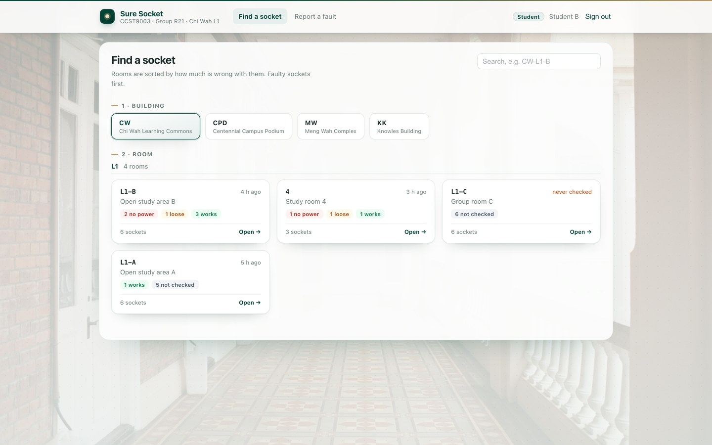
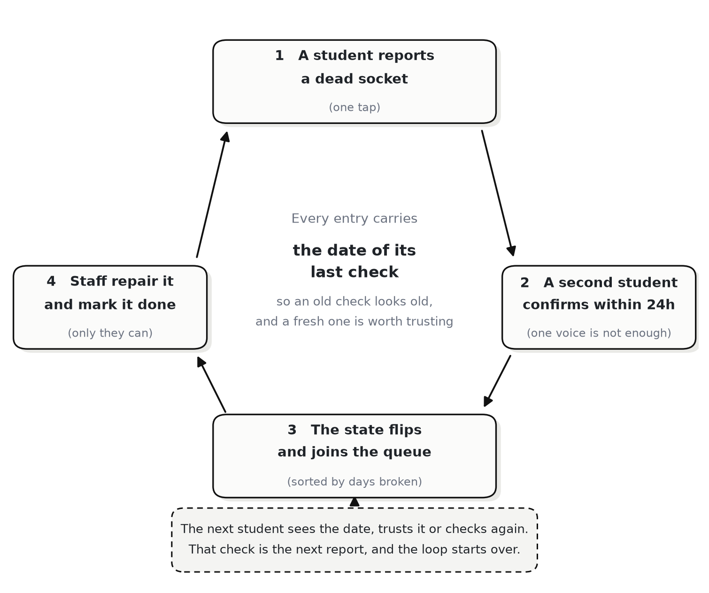
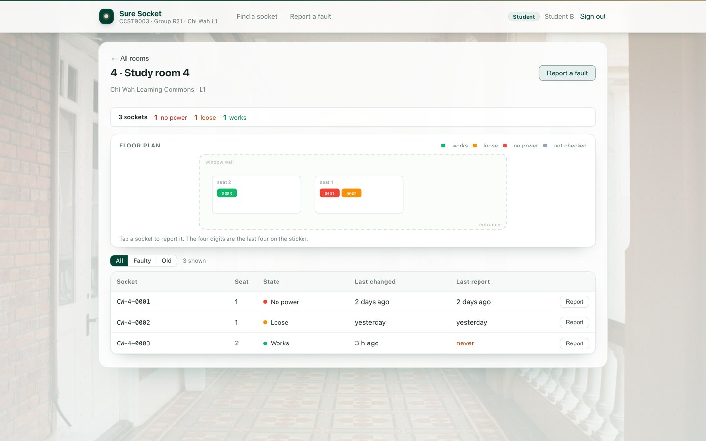
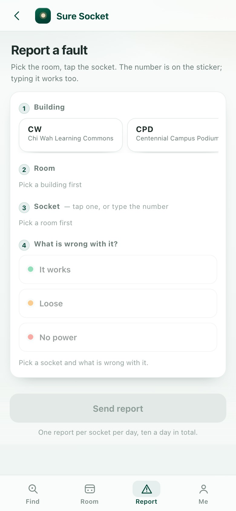

# Sure Socket

**One student reports a dead socket, a second confirms it, staff repair it, the next reader sees the date.**

<a href="scripts/check-readmes.sh"></a> <a href="docs/technical.md"></a> 

[简体中文](README.zh-CN.md) · [繁體中文](README.zh-TW.md)

[Docs](docs/README.md) · [Technical](docs/technical.md) · [Deployment](docs/deployment.md) · [Screens](docs/screens.md)



## What it is

Sure Socket answers one question at the moment it matters: can I charge my laptop at this desk? Pick a building, then a room; sockets are coloured by their last known state.

The unit is the socket, not the room: a mostly-fine room is no use when the free desk is dead. Each socket carries its own code (`CPD-LG01-0001`: building, room, sequence, never reused) and history.

→ [The 90-second tour](docs/highlights.md)

## The loop

Nothing is sensed and nothing is kept by hand: each step rewards the next person.

1. A student opens a room and sees each socket's last check.
2. A dead one is reported in three taps from the room: what is wrong, no photo, no free text.
3. A second student agrees, and only then does the state change.
4. Staff take the queue oldest first and mark each socket repaired.
5. The next student sees the repair and its date, and checks again.



→ [How the loop works, step by step](docs/loop.md)

## Screens

One build, two roles: students see *Find a socket* and *Report a fault*, the estates office sees the repair queue. A wrong role does not hide a button; the API refuses.

| A room, laptop | Reporting, phone |
|---|---|
|  |  |

→ [All screens, desktop and phone](docs/screens.md)

## Why the state can be trusted

Rules are few, enforced server-side; staff alone may close a repair.

- A state needs 1.6 from the three heaviest accounts in 72 hours, and a 1.5× lead.
- Accounts weigh 0.5 to 1.5, so two fresh accounts can flip a socket and one cannot.
- One report per socket per day and ten per account per day, both answering HTTP 429.

Known limits: checks older than 30 days go stale, tokens live in memory, login has no rate limit.

→ [The rules, the numbers and the known limits](docs/trust.md)

## Run it

Postgres 17, the API and the Vue build start together, schema migrated, accounts seeded.

```bash
docker compose up --build    # Postgres 17, the API, the Vue build, seeded accounts
open http://localhost:8080   # the room picker
docker compose down -v
docker compose logs -f backend
```

Password `demo1234` for `student1@connect.hku.hk` and `student2@connect.hku.hk` (the pair clears 1.6) and for `estates@hku.hk`.

→ [Deployment, environment variables and resets](docs/deployment.md)

## How it fits together

- **Backend** — Spring Boot on Java 21, PostgreSQL 17, Flyway; rules are pure functions, testable without a database.
- **Frontend** — Vue 3 and Vite, one build for both roles; the room plan is an SVG component.
- **Serving** — nginx serves the build and proxies `/api`: one origin, so CORS never applies.

→ [Architecture and the data path](docs/architecture.md)

## Documentation

| Page | Answers | Length |
|---|---|---|
| [The 90-second tour](docs/highlights.md) | What is this, who is it for, what does it look like | 2 min |
| [The loop](docs/loop.md) | Who acts at each step, and what moves a socket between states | 4 min |
| [Why the state can be trusted](docs/trust.md) | The evidence rule in numbers, the rate limits, the known limits | 5 min |
| [Features](docs/features.md) | Every capability, per role, and where to see it | 3 min |
| [Architecture](docs/architecture.md) | Three processes, the rules, and the path a report takes | 5 min |
| [Screens](docs/screens.md) | The screens, desktop and phone | 1 min |
| [Technical reference](docs/technical.md) | Schema, endpoints, rules as code, what comes next | 12 min |
| [Deployment](docs/deployment.md) | Docker, environment variables, backup, reset, failures | 6 min |

Chinese versions: [technical](docs/technical.zh-CN.md) · [technical, 繁](docs/technical.zh-TW.md) · [deployment](docs/deployment.zh-CN.md) · [deployment, 繁](docs/deployment.zh-TW.md).

---

Coursework for HKU CCST9003, Group R21; not licensed for reuse.
