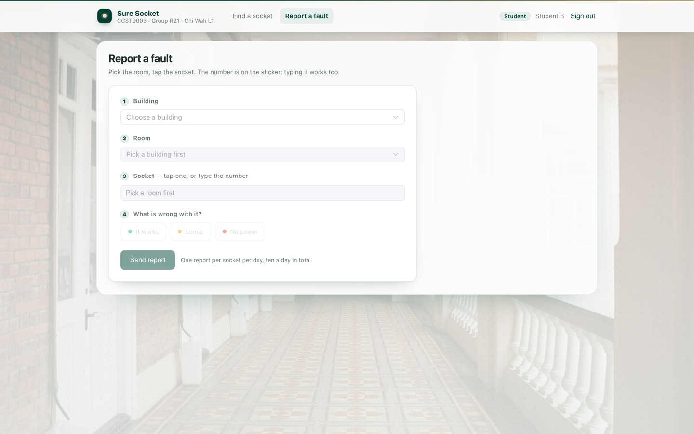
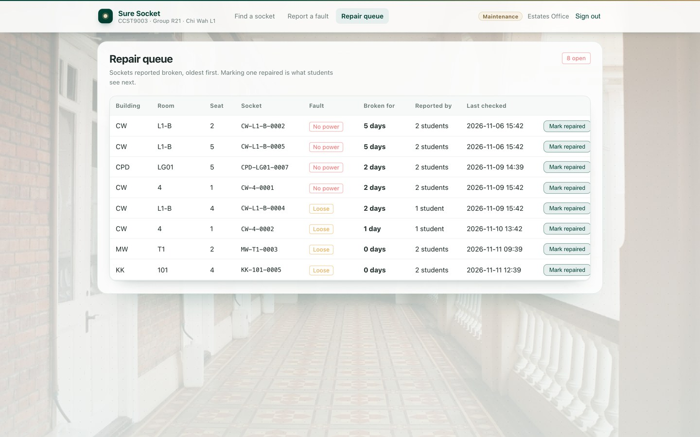
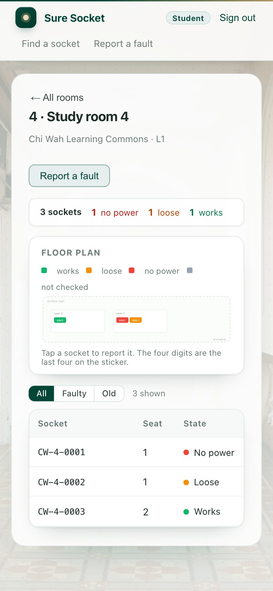

# Sure Socket

**Know the socket works before you sit down.** A web app that tells a student whether the power socket at a given desk is live — and hands the estates office an ordered list of the ones that are not.

English · [简体中文](README.zh-CN.md) · [繁體中文](README.zh-TW.md)


## What this is

Sure Socket answers one question at the moment it matters: *can I charge my laptop at this desk?* You pick a building, then a room. The room shows a plan of its desks with every socket coloured by its last known state, plus a list you can filter down to the faulty ones and to the checks that are getting old.

A room that is "mostly fine" is no help when the only free desk is the dead one. So the unit of the product is the socket: each one carries its own number, its own state, its own last-checked date, and its own history of reports and repairs.

This release covers CW, CPD, MW and KK — four campus buildings, with sample rooms and sample sockets — and serves two roles from one application: students who report, and the estates office that repairs. Every screen works the same on a phone as on a laptop, because the person reporting a fault is standing at a desk with one hand free.

## Why a socket, not a room

Booking systems count rooms and desks. Repair systems count faults. Neither of them can tell you whether the thing you actually need — a live socket — is working at the seat you are about to take. So a student arrives at a room that is booked, free and correct in every system, and finds a socket that has been dead for a month.

Sure Socket records the one object both sides care about, and it records it at the resolution people experience it: one socket, on one desk, in one room. That is also what makes the data cheap to keep honest — a claim about a single socket is small enough for a passer-by to check in two seconds.

### The socket number

Every socket carries a number, printed on a sticker on the desk. A student reads it off the furniture, the room list repeats it, staff see the same string in the repair queue, and the database refuses two sockets with the same one.

```
  CPD        -  LG01       -  0001
  building      room          sequence within the room
```

- The building code and the room code are HKU's own. `CPD`, `MW` and `LG01` are already on signage and in timetables, so nobody has to learn a second name for a place they already know.
- The room code does not repeat the building, and the sequence is per room — four digits, starting at `0001`.
- A number is assigned once and never reused. Renaming a room or adding a seat does not renumber the sockets that already exist, because a sticker on a desk outlives a spreadsheet.
- Uniqueness is enforced by an index on `socket.code`, not by good intentions. A duplicate number is a database error, not a display bug.

## The loop

There are no sensors in this build and nobody maintaining the database by hand. Everything the app knows comes from one loop, and the loop turns because every step gives the next person a reason to take it.

1. A student opens a room and sees each socket with the date it was last checked.
2. If it is dead, they report it in one tap. Nothing else is asked of them — no photo, no comment, no account to create.
3. A second student reports the same thing within 24 hours, and the state changes. One voice is not enough, so nobody can mark a floor alone on a bad afternoon.
4. The queue is ordered by how long a socket has been broken, so staff start with the worst one and mark it repaired when they are done.
5. The next student sees "repaired" with the date, and either trusts it or checks again. That check is the next report, and the loop starts over.

A socket is described with five words, and nothing else:

- **works** — someone checked it and it charged a laptop.
- **loose** — it charges, but the plug falls out.
- **no power** — dead.
- **repaired** — staff closed a fault and stamped the time.
- **not checked** — nobody has looked yet, which is said out loud rather than guessed at.


## Screens

One build, two roles. A student sees *Find a socket* and *Report a fault*; the estates office sees the *Repair queue* instead of the report form. Being signed in as the wrong role does not hide a button — the API refuses the request.

| Room, plan and list | Report a fault | Repair queue |
|---|---|---|
|  |  |  |

On a phone the same screens reflow into one column — the plan first, because that is what you tap when you are standing at the desk:

| Room on a phone | Report on a phone |
|---|---|
|  |  |

## How the record stays honest

Crowd-sourced data is worth exactly as much as its resistance to being wrong, so the rules are few, visible and enforced where they cannot be argued with.

- **A socket flips on weighted evidence, not a headcount.** Every account carries a weight from its record, 0.5 to 1.5, and the weights behind one state must add up to 1.6 and lead any rival by half again, counting the three heaviest accounts in the last 72 hours. Two fresh accounts (1.0 + 1.0) clear it; one expert, capped at 1.5, never can on their own.
- **One report per account per socket per day, ten per account per day.** The first stops one person stacking evidence on a single socket; the second stops one person sweeping a whole floor in an hour. Both answer HTTP 429 when they bite.
- **Old checks are labelled old.** Past 30 days a check is flagged in the interface until somebody looks again, and nothing is silently presented as fresh.
- **The score moves only when a repair settles a report.** A repair that agrees with what was reported adds to that account's confirmed count, one that disagrees adds to refuted; the score is confirmed over settled, held near 0.5 for a new account by a prior. Nothing else moves it, so filing more reports earns nothing.
- **Only maintenance can close a fault.** A repair sets the state to repaired and stamps the time; that stamp is what the next student reads.
- **Every row carries a timestamp**, so "2 days ago" and "never" are facts the app can stand behind rather than a vague assurance.
- **The rules live server-side.** The UI cannot grant itself a second report, a role, or a state change; it only renders what the API returns.

What that leaves as known limits, said plainly: tokens live in memory, so restarting the API signs everyone out; the login endpoint has no rate limit yet; and the seed data is a sample, not a survey.

## Architecture

Three processes and one database, all of them ordinary, because the interesting part of this product is the record and not the plumbing.

- **Backend** — Spring Boot 4.1 on Java 21, Spring Data JPA, Flyway migrations V1–V8, PostgreSQL 17. The rules are pure functions in `Rules.java`, kept out of the services so they can be tested without a database.
- **Frontend** — Vue 3 with Vite and Element Plus, one build serving both roles; the room plan is a small SVG component, not a screenshot of a floor.
- **Serving** — the production image puts the Vue build behind nginx, which serves the app and proxies `/api` to the backend, so the browser sees one origin and CORS never comes into it.
- **Auth** — email and password, BCrypt hashes, a token held in memory, and the role checked on every write in the controller rather than in the view.
- **Data path** — a report appends a row, then the service sums the weights of the accounts behind each candidate state over the last 72 hours; the socket row only moves when one state clears 1.6 and leads its rival. A repair settles every report in that window, which is what moves the scores. History is never overwritten.

## What is in the box

- `backend/` — the Spring Boot API: controllers, services, pure rules, Flyway migrations, seed data, tests.
- `frontend/` — the Vue 3 application, one build serving both roles.
- `scripts/` — setup-db, start, stop, the test runner, and an end-to-end walkthrough.
- `docs/` — screenshots, the loop diagram, technical notes and deployment notes.

Also included: three demo accounts so the two-report rule can actually be demonstrated, a demo reset script that puts the sample data back, and an end-to-end script that drives the loop through the API from report to repair.

## Running it locally

Docker is the shortest path — Postgres, the API and the web app start together, with the schema migrated and the demo accounts seeded:

```bash
docker compose up --build          # Postgres 17 + Spring Boot API + Vue build behind nginx
open http://localhost:8080         # sign in with one of the accounts below
```

The compose file is three services, and everything adjustable is an environment variable:

```yaml
services:
  db:
    image: postgres:17-alpine
    volumes: [socketfinder-data:/var/lib/postgresql/data]
  backend:
    build: ./backend
    environment:
      SF_DB_URL: jdbc:postgresql://db:5432/socketfinder
  frontend:
    build: ./frontend
    ports: ["${SF_WEB_PORT:-8080}:80"]
```

The database lives in a named volume, so `docker compose down -v` is what gets you a clean one, and `docker compose up -d db` starts only the database. Without Docker you need Java 21, Maven, Node 18+ and PostgreSQL 17; `./scripts/start-all.sh` brings up the database first, then the API on :8081 and the frontend on :5175, and `./scripts/stop-all.sh` stops them. `scripts/setup-db.sh` decides where the database lives — an existing server if you set `SF_DB_URL`, Docker if it is available, otherwise its own cluster under `db/pgdata` on the first free port — and running it twice is harmless.

Password for all three accounts is `demo1234`:

| Email | Role | Why it exists |
|---|---|---|
| student1@connect.hku.hk | student | first reporter |
| student2@connect.hku.hk | student | second reporter — two accounts clear the 1.6 threshold, one cannot |
| estates@hku.hk | maintenance | sees the repair queue |

Ports and credentials are environment variables with working defaults: `SF_DB_URL`, `SF_DB_USER`, `SF_DB_PASSWORD`, `SF_BIND`, `SF_PORT`, `SF_WEB_PORT`, `SF_REPORTS_NEEDED`, `SF_REPORTS_PER_DAY`.

## Documentation

| Document | What is in it |
|---|---|
| [Technical notes](docs/technical.md) | data model, rules, request flow, endpoints, and where the design goes next |
| [Technical notes, 简体中文](docs/technical.zh-CN.md) | the same, in Simplified Chinese |
| [Technical notes, 繁體中文](docs/technical.zh-TW.md) | the same, in Traditional Chinese |
| [Deployment](docs/deployment.md) | environment variables, backup and reset, health checks, the failures worth knowing |
| [Deployment, 简体中文](docs/deployment.zh-CN.md) | the same, in Simplified Chinese |
| [Deployment, 繁體中文](docs/deployment.zh-TW.md) | the same, in Traditional Chinese |

This README exists in three languages. Any change to one is made in all three in the same commit, and `scripts/check-readmes.sh` fails the build when the three drift apart in structure.

## Roadmap

- A real floor plan under the schematic: the room outline taken from the building's own drawing, with seats placed by coordinates instead of the tidy grid used here.
- Photos on reports, a notification when a socket you rely on changes state, and a usable view for the basement where the signal is poor.
- Room and socket data for the whole campus, imported one building at a time.
- Self-registration with email verification, so the two-report rule works with real accounts instead of three seeded ones.
- Rate limiting on login, and tokens that survive a restart.
- A native phone build once the web app has been used enough to justify one.

The scope of each step is set at the review after the previous release, and each release is expected to leave the loop working end to end.

---

Sure Socket is built at HKU as a CCST9003 group project (Group R21). The course ends; the socket on your desk is still the unit.
