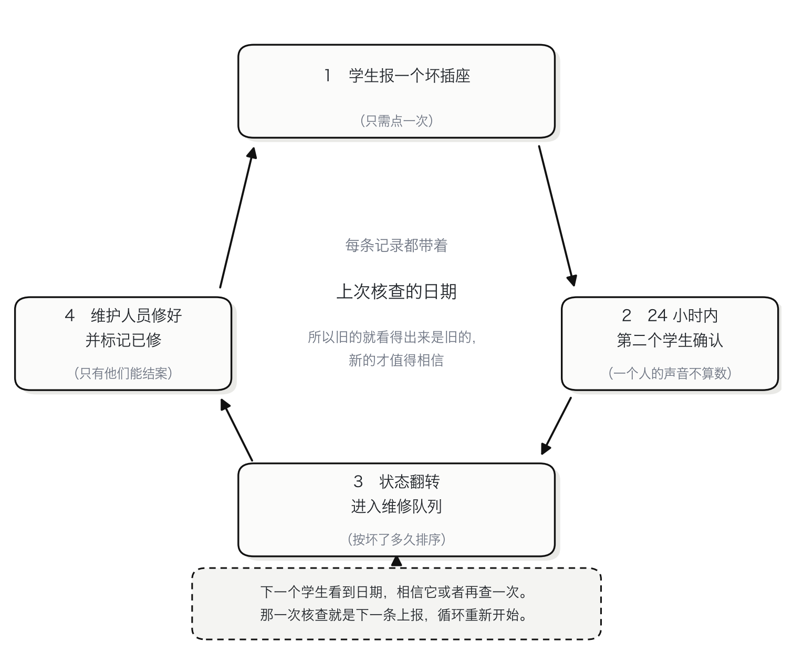

# Socket Finder 插座查询

**找一个能充电的座位。** 一个网页应用，在学生坐下之前就告诉他：这张桌子的电源插座到底能不能用。

[English](README.md) · 简体中文 · [繁體中文](README.zh-TW.md)


## 这是什么

港大 CCST9003 小组项目（第 R21 组）。这个仓库是**迭代 1**：一个插座，从查到报走完一圈。
打开房间 → 打开插座 → 报它坏了 → 看状态翻转。

整个设计的单位是**插座**，不是房间。订位系统数的是房间和桌子，报修系统数的是故障，
两者都不知道你这台笔记本到底能不能在这里充电。

### 插座编号

每个插座都有一个编号，这个编号是整个产品的计量单位：学生从桌牌上读它，维护人员从队列里读到同一个字符串，数据库也不允许两个插座用同一个编号。

```
CPD-LG01-0001        MW-T1-5445
楼      房间   序号
```

- 楼号（building code）和房间号（room code）都用港大自己的写法。`CPD`、`LG01` 本来就写在指示牌和课表上，大家不用为一个熟悉的地方再记一套名字。
- 房间号里不再重复楼号；序号按房间排，从 `0001` 开始，固定四位。
- 编号只分配一次。房间改名或新增座位，都不会重排已经存在的插座，因为贴在桌上的牌子比表格活得久。

## 数据怎么自己转起来

这里没有传感器，也没有专门手工维护数据库的人。系统知道的每件事都来自同一个循环，而循环能转，是因为每一步都给了下一个人动手的理由。

1. 学生打开房间，每个插座都标着上次核查的日期。
2. 如果是坏的，点一下就报，不要求他填别的东西。
3. 24 小时内第二个学生报了同样的结果，状态才改变。一个人的声音不算数，所以没人能独自把一层楼标完。
4. 队列按「坏了多久」排序，维护人员先修最难受的那几个，修完标已修。
5. 下一个学生看到「已修」和日期，要么信它，要么再查一次 —— 那一次核查就是下一条上报，循环重新开始。



两个细节让它转得下去：每条记录都带日期，所以旧的就是旧的，不会被当成新的卖；30 天这条线把「我不确定」变成一个动作，而这个动作只要点一次。

## 界面

| 房间页 | 维修队列 |
|---|---|
|  |  |

## 技术说明

这份实现背后的设计，写在这里：[English](docs/technical.md) · [简体中文](docs/technical.zh-CN.md) · [繁體中文](docs/technical.zh-TW.md)。

## 技术栈

技术栈：

- **后端**：Spring Boot 4.1、Java 21、Spring Data JPA、Flyway、PostgreSQL 17
- **前端**：Vue 3 + Vite + Element Plus，一个应用服务两个角色
- **鉴权**：邮箱 + 密码（BCrypt），token 存在内存里，每次写入都校验角色

## 怎么跑

### Docker：一条命令起全套

```bash
docker compose up --build
open http://localhost:8080
```

数据库、接口、网页一起起来。数据放在命名卷里，想要干净的库就 `docker compose down -v`；只想起数据库用 `docker compose up -d db`。

### 不用 Docker

有 Java 21、Maven、Node 18+、PostgreSQL 17 就够：

```bash
./scripts/start-all.sh      # 先准备数据库，再起后端 8081 和前端 5175
open http://localhost:5175
```

`scripts/setup-db.sh` 自己决定数据库放哪：你设了 `SF_DB_URL` 就用现成的服务；有 Docker 就用 Docker；都没有就在 `db/pgdata` 里建一个本项目专属的集群，端口从第一个空闲的开始找。重复运行没有副作用。

端口和账号都是环境变量，有可用默认值：`SF_DB_URL`、`SF_DB_USER`、`SF_DB_PASSWORD`、`SF_BIND`、`SF_PORT`、`SF_WEB_PORT`。

停止用 `./scripts/stop-all.sh`。
## 部署文档

环境变量分别管什么、数据库怎么备份、容器起不来先看哪里：[English](docs/deployment.md) · [简体中文](docs/deployment.zh-CN.md) · [繁體中文](docs/deployment.zh-TW.md)。

## 演示账号（密码都是 `demo1234`）

| 邮箱 | 角色 | 用途 |
|---|---|---|
| student1@connect.hku.hk | 学生 | 第一个上报的人 |
| student2@connect.hku.hk | 学生 | 第二个上报的人，翻转状态必须两个账号 |
| estates@hku.hk | 维护人员 | 看维修队列 |

## 接口

| 方法 | 路径 | 谁能调 | 做什么 |
|---|---|---|---|
| POST | `/api/auth/login` | 所有人 | 邮箱 + 密码，返回 token |
| GET | `/api/auth/demo-accounts` | 所有人 | 三个演示账号，登录页用 |
| GET | `/api/buildings` | 所有人 | 楼宇与楼层 |
| GET | `/api/floors/{id}/rooms` | 所有人 | 某层的房间与插座数量 |
| GET | `/api/rooms/{id}` | 所有人 | 房间里的座位和插座 |
| POST | `/api/sockets/{id}/report` | 学生 | 上报 `WORKING`、`LOOSE` 或 `NO_POWER` |
| POST | `/api/sockets/{id}/repair` | 维护人员 | 标记已修，可写备注 |
| GET | `/api/maintenance/queue` | 维护人员 | 报坏的插座，按坏得最久排前 |

## 这一版实现了的规则

- **两个人才翻转**：24 小时内两个不同账号报同一状态。只报一次会存下来，但界面显示「未确认」。
- **每账号每插座每天一次，且每账号每天最多 10 次**：前者防止一个人单独翻转一支插座，后者防止一个人一小时内扫完一层楼。超限都返回 HTTP 429。
- **旧的核查会标旧**：超过 30 天，界面直接标「旧」，不假装它是新的。
- **只有维护人员能结案**：标记已修后状态变 `REPAIRED` 并打时间戳，学生看到的就是这个。
- **角色分离由 API 执行**，不是前端把按钮藏起来。

## 接下来打算做

- 每层一张平面图，房间从列表变成一张图。
- 上报可以带照片；常用的插座状态变了能收到通知；地下室这种信号差的地方能离线查看。
- 全校的房间与插座数据，按楼逐栋导入。
- 学生邮箱验证与自助注册。
- 网页版用得够多之后，再考虑手机端。

每一步的范围，都在上一轮迭代评审时确定。

## 原型阶段的已知限制

- token 存在内存里，后端一重启所有人都要重新登录。
- 密码用 BCrypt，但登录接口没有频率限制。
- 种子数据是样例，不是对某一层楼的真实清点。

## 目录结构

```
backend/   Spring Boot 接口、Flyway 迁移、种子数据、单测
frontend/  Vue 3 应用（一份 build，两个角色）
scripts/   启停、测试、端到端
docs/      截图
```

---

**三份 README 必须同步。** 本项目有英文、简体中文、繁体中文三份 README，任何改动都要在同一次提交里三份一起改。
`scripts/check-readmes.sh` 会检查三份结构是否一致，每次推送前跑。
