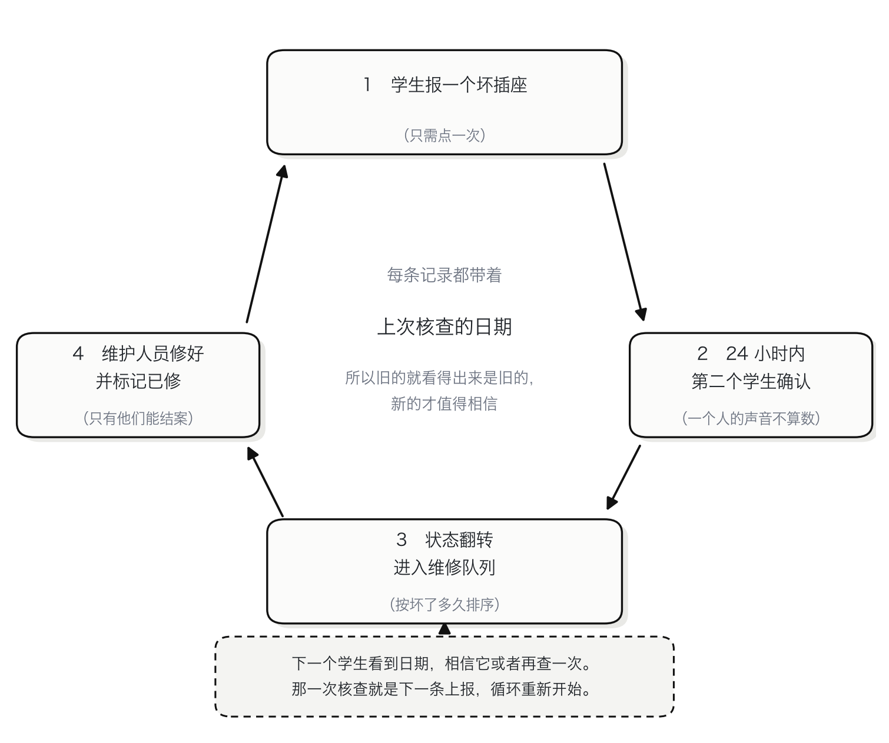

# Sure Socket

**先找一个能充电的座位。** 一个网页应用，在学生坐下之前就告诉他：这张桌子的电源插座到底能不能用。

简体中文 · [English](README.md) · [繁體中文](README.zh-TW.md)


## 这是什么

港大 CCST9003 小组项目（第 R21 组）。这个仓库是**迭代 1**：一个插座，从查到报，走完一整圈。

系统里没有传感器，也没有人手工维护数据库。应用知道的每一件事，都来自学生或维修人员在界面上的一次点击。

## 为什么是插座，不是房间

订位系统数的是房间和桌子，报修系统数的是故障单，两者都不知道你这台笔记本能不能在这里充上电。房间页面上写着「有电」，可那张桌子底下的插座可能早就松了，也可能根本没通电。

所以设计的单位是插座，不是房间：一个插座一个状态，一个插座一个编号，谁都不用去猜一个平均值。

### 插座编号

每个插座都有一个编号，整个产品都围着这个编号转：学生从桌子上的贴纸读它，维修人员在队列里读到同一个字符串，数据库也不允许两个插座用同一个编号。

```
CPD-LG01-0001
楼栋   房间   序号
```

- 楼栋代码和房间代码用的都是港大自己的写法。`CPD`、`LG01` 本来就印在指示牌和课表上，没人需要为一个已经熟悉的地方再记一套名字。
- 房间代码里不重复楼栋代码；序号按房间排，四位，从 `0001` 开始。
- 编号只分配一次，永不复用。房间改名或者加座位，都不会重排已经存在的插座，因为贴在桌上的贴纸比表格活得久。

## 循环

这里没有传感器，也没有人靠手工维护数据。应用知道的每件事都来自同一个循环，而循环能转起来，是因为每一步都给了下一个人动手的理由。

1. 学生打开房间，每个插座都标着上次核查的日期。
2. 如果是坏的，点一下就报，不要求他再填别的东西。
3. 另一个学生报了同样的状态，插座才翻转。一个人的声音不算数，所以没人能独自把一层楼标完。
4. 队列按「坏了多久」排序，维修人员先修最难受的那几个，修完再标已修。
5. 下一个学生看到「已修」和日期，要么信它，要么再查一次——那一次核查就是下一条上报，循环重新开始。



两个细节让它一直转下去：每条记录都带日期，旧核查看起来就旧，没人会把一个过期状态当成刚查过；而放太久的插座会被标成「该重新核查了」，把一次犹豫变成一个只需点一下的动作。

## 界面

桌面端的房间页把平面图和插座列表放在一起，同一个页面里既能看位置，也能看状态。


同一套应用在手机上也能用，站在桌子前面就能查、就能报。


## 记录如何保持可信

众包数据的价值，等于它抗错的能力。规则不多，但都写在看得见的地方，并且由服务端执行。

- **翻转靠加权证据，不靠人数。** 每个账号的权重来自它的记录，0.5 到 1.5；支持同一状态的上报者权重之和必须达到 1.6，且比任何竞争状态高出五成，只取最近 72 小时内最重的三个账号。两个新账号（1.0 + 1.0）足够，而一个满分账号被封顶在 1.5，单靠永远不够。
- **同账号同插座每天一条，每个账号每天十条。** 前者防止一个人单独改变一支插座，后者防止一个人一小时内扫完整层楼。两条触发时都返回 HTTP 429。
- **旧核查会被标成旧。** 超过 30 天，界面会标出「久未核查」，直到有人再看一眼，不会把旧数据当新的给你。
- **只有维护人员能关闭故障。** 标记维修把状态置为「已修复」并写入时间戳，之后的学生读到的就是这个时间。
- **每一行都带时间戳**，所以「2 天前」和「从未」都是系统能站得住的事实。
- **规则在后端。** 界面没法给自己多发一条上报、多要一个角色、或者改一个状态。

信誉分已经跑在系统里（`V8` 迁移加了 confirmed / refuted 两列）：分数 = 已确认 ÷ 已结算，新账号因先验停在 0.5，权重 0.5–1.5，阈值 1.6，所以一个人翻不动一支插座。**还没实现的是奖励**——徽章与代金券仍写在设计里，代码里没有。

已知限制同样照实说：token 存在内存里，重启 API 所有人要重新登录；登录接口还没有限流；种子数据是样例，不是普查。

## 架构

三块，边界清楚：

- **后端**：Spring Boot，Java，Spring Data JPA，PostgreSQL 存数据，Flyway 管迁移。
- **前端**：Vue 3，一个构建同时服务学生和维修人员两个角色，界面按角色收窄入口。
- **规则层**：上报合并、每日上限、信誉权重、队列排序、角色权限全部留在后端，任何写入都要过这一层。前端只是把服务端的判断画出来。

## 仓库里有什么

- `backend/`：Spring Boot 接口、数据库迁移、种子数据和单元测试。
- `frontend/`：Vue 3 应用，一次构建，两个角色。
- `scripts/`：启动、停止、测试、端到端脚本，以及结构检查脚本。
- `docs/`：技术文档、部署文档、界面截图和循环示意图。

## 本地运行

Docker 一条命令起全套：

```bash
docker compose up --build
open http://localhost:8080
```

没有 Docker 也行，Java、Maven、Node 和 PostgreSQL 就够：

```bash
./scripts/start-all.sh
open http://localhost:5175
```

数据库放在哪里由 `scripts/setup-db.sh` 决定：设了 `SF_DB_URL` 就用现成的服务器，否则有 Docker 就用 Docker，再不然就在 `db/pgdata` 里起自己的实例，端口从第一个空闲的开始找。端口和账号都是带默认值的环境变量，跑第二遍不会出问题。停止用 `./scripts/stop-all.sh`。

## 文档

- 技术设计：[English](docs/technical.md) · [简体中文](docs/technical.zh-CN.md) · [繁體中文](docs/technical.zh-TW.md)
- 部署与运维：[English](docs/deployment.md) · [简体中文](docs/deployment.zh-CN.md) · [繁體中文](docs/deployment.zh-TW.md)

## 后续计划

- 平面图做成真的：用楼栋自己的图纸，座位按坐标摆放，而不是现在这个整齐的网格。
- 上报可以附照片；你常用的插座状态变了会收到通知；地库信号差的时候也能看。
- 整个校园的房间和插座数据，一栋楼一栋楼导入。
- 学生邮箱验证和自助注册。
- 网页版用得足够多之后，再考虑手机端。

每一步的范围都在上一轮迭代的复盘中定下来。这一版仍是原型：令牌存在内存里，重启后端所有人都会被登出；登录接口还没有限流；种子数据是样例，不是对真实某一层楼的测绘。
