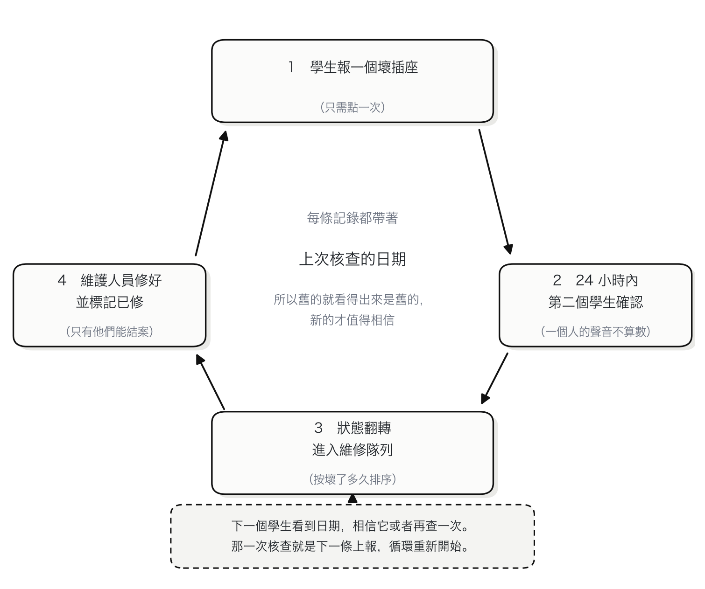

# Sure Socket

**先找一個能充電的座位。** 一個網頁應用，在學生坐下之前就告訴他：這張桌子的電源插座到底能不能用。

[English](README.md) · [简体中文](README.zh-CN.md) · 繁體中文


## 這是什麼

港大 CCST9003 小組專案（第 R21 組）。這個儲存庫是**迭代 1**：一個插座，從查到報，走完一整圈。

系統裡沒有感測器，也沒有人手工維護資料庫。應用程式知道的每一件事，都來自學生或維修人員在介面上的一次點擊。

## 為什麼是插座，不是房間

訂位系統數的是房間和桌子，報修系統數的是故障單，兩者都不知道你這台筆記型電腦能不能在這裡充電。房間頁面上寫著「有電」，可那張桌子底下的插座可能早就鬆了，也可能根本沒通電。

所以設計的單位是插座，不是房間：一個插座一個狀態，一個插座一個編號，誰都不用去猜一個平均值。

### 插座編號

每個插座都有一個編號，整個產品都圍著這個編號轉：學生從桌子上的貼紙讀它，維修人員在佇列裡讀到同一個字串，資料庫也不允許兩個插座用同一個編號。

```
CPD-LG01-0001
樓棟   房間   序號
```

- 樓棟代碼和房間代碼用的都是港大自己的寫法。`CPD`、`LG01` 本來就印在指示牌和課表上，沒人需要為一個已經熟悉的地方再記一套名字。
- 房間代碼裡不重複樓棟代碼；序號按房間排，四位，從 `0001` 開始。
- 編號只分配一次，永不重複使用。房間改名或者加座位，都不會重排已經存在的插座，因為貼在桌上的貼紙比表格活得久。

## 循環

這裡沒有感測器，也沒有人靠手工維護資料。應用程式知道的每件事都來自同一個循環，而循環能轉起來，是因為每一步都給了下一個人動手的理由。

1. 學生打開房間，每個插座都標著上次核查的日期。
2. 如果是壞的，點一下就報，不要求他再填別的東西。
3. 另一個學生報了同樣的狀態，插座才翻轉。一個人的聲音不算數，所以沒人能獨自把一層樓標完。
4. 佇列按「壞了多久」排序，維修人員先修最難受的那幾個，修完再標已修。
5. 下一個學生看到「已修」和日期，要嘛信它，要嘛再查一次——那一次核查就是下一條上報，循環重新開始。



兩個細節讓它一直轉下去：每條記錄都帶日期，舊核查看起來就舊，沒人會把一個過期狀態當成剛查過；而放太久的插座會被標成「該重新核查了」，把一次猶豫變成一個只需點一下的動作。

## 介面

桌面端的房間頁把平面圖和插座清單放在一起，同一個頁面裡既能看位置，也能看狀態。


同一套應用在手機上也能用，站在桌子前面就能查、就能報。


## 記錄如何保持可信

群眾外包資料的價值，等於它抗錯的能力。規則不多，但都寫在看得見的地方，並且由服務端執行。

- **兩個不同帳號才能翻轉一支插座。** 同一狀態、24 小時之內。單條上報照樣儲存，只顯示為「待確認」，並告訴你還差幾次。
- **同帳號同插座每天一條，每個帳號每天十條。** 前者防止一個人單獨改變一支插座，後者防止一個人一小時內掃完整層樓。兩條觸發時都回傳 HTTP 429。
- **舊核查會被標成舊。** 超過 30 天，介面會標出「久未核查」，直到有人再看一眼，不會把舊資料當新的給你。
- **只有維護人員能關閉故障。** 標記維修把狀態設為「已修復」並寫入時間戳，之後的學生讀到的就是這個時間。
- **每一列都帶時間戳**，所以「2 天前」和「從未」都是系統站得住的事實。
- **規則在後端。** 介面沒辦法給自己多發一條上報、多要一個角色、或者改一個狀態。

正在設計、**還沒實作**的部分也寫在這裡：信譽分（已確認 ÷ 已結算）、加權投票（門檻 1.6，單帳號權重上限 1.5，所以一個人永遠翻不動）、以及徽章與折抵券。今天的版本仍然是「兩個不同帳號」，我們寧可把差異寫明。

已知限制同樣照實說：token 存在記憶體裡，重啟 API 所有人要重新登入；登入介面還沒有流量限制；種子資料是樣本，不是普查。

## 架構

三塊，邊界清楚：

- **後端**：Spring Boot，Java，Spring Data JPA，PostgreSQL 存資料，Flyway 管遷移。
- **前端**：Vue 3，一個建置同時服務學生和維修人員兩個角色，介面按角色收窄入口。
- **規則層**：上報合併、每日上限、信譽權重、佇列排序、角色權限全部留在後端，任何寫入都要過這一層。前端只是把伺服器端的判斷畫出來。

## 儲存庫裡有什麼

- `backend/`：Spring Boot 介面、資料庫遷移、種子資料和單元測試。
- `frontend/`：Vue 3 應用，一次建置，兩個角色。
- `scripts/`：啟動、停止、測試、端對端腳本，以及結構檢查腳本。
- `docs/`：技術文件、部署文件、介面截圖和循環示意圖。

## 本地執行

Docker 一條命令起全套：

```bash
docker compose up --build
open http://localhost:8080
```

沒有 Docker 也行，Java、Maven、Node 和 PostgreSQL 就夠：

```bash
./scripts/start-all.sh
open http://localhost:5175
```

資料庫放在哪裡由 `scripts/setup-db.sh` 決定：設了 `SF_DB_URL` 就用現成的伺服器，否則有 Docker 就用 Docker，再不然就在 `db/pgdata` 裡起自己的實例，埠號從第一個空閒的開始找。埠號和帳號都是帶預設值的環境變數，跑第二遍不會出問題。停止用 `./scripts/stop-all.sh`。

## 文件

- 技術設計：[English](docs/technical.md) · [简体中文](docs/technical.zh-CN.md) · [繁體中文](docs/technical.zh-TW.md)
- 部署與維運：[English](docs/deployment.md) · [简体中文](docs/deployment.zh-CN.md) · [繁體中文](docs/deployment.zh-TW.md)

## 後續計畫

- 平面圖做成真的：用樓棟自己的圖紙，座位按座標擺放，而不是現在這個整齊的網格。
- 上報可以附照片；你常用的插座狀態變了會收到通知；地下室訊號差的時候也能看。
- 整個校園的房間和插座資料，一棟樓一棟樓匯入。
- 學生電郵驗證和自助註冊。
- 網頁版用得足夠多之後，再考慮手機端。

每一步的範圍都在上一輪迭代的複盤中定下來。這一版仍是原型：權杖存在記憶體裡，重啟後端所有人都會被登出；登入介面還沒有流量限制；種子資料是樣本，不是對真實某一層樓的測繪。
