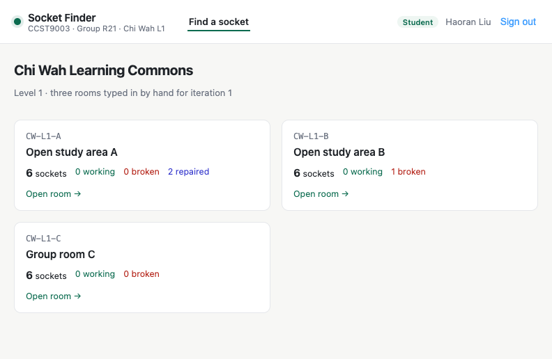
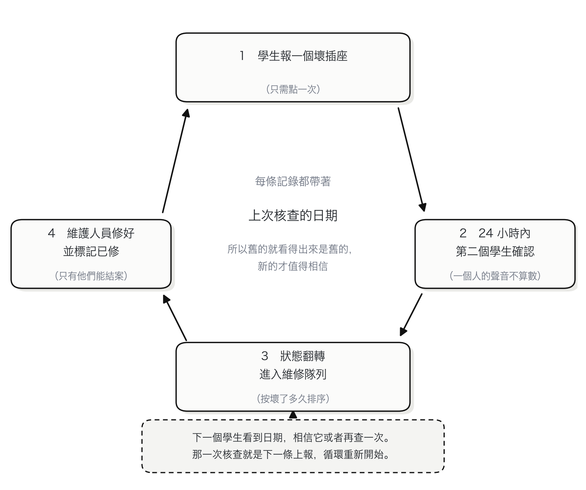
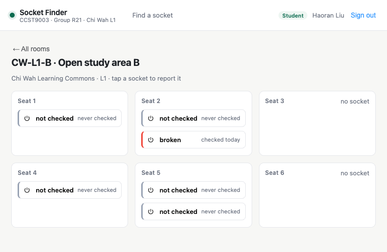
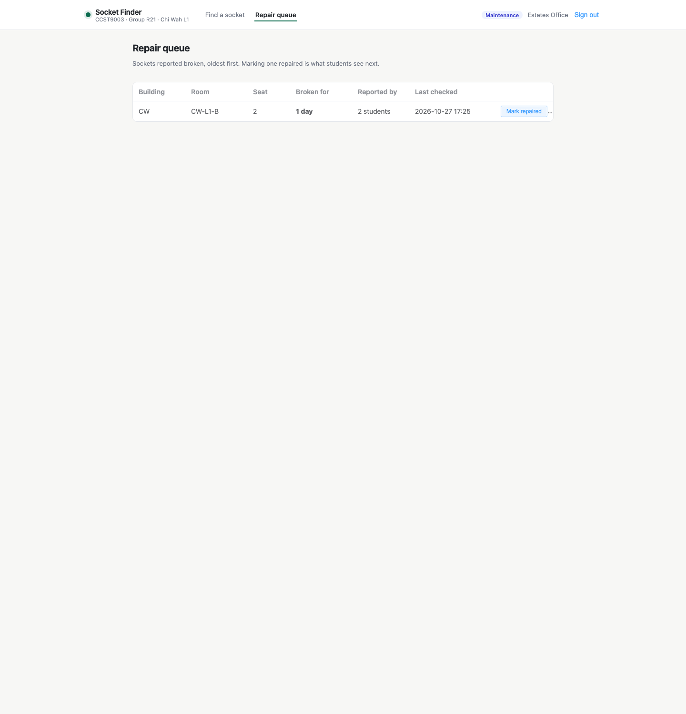

# Socket Finder 插座查詢

**找一個能充電的座位。** 一個網頁應用，在學生坐下之前就告訴他：這張桌子的電源插座到底能不能用。

[English](README.md) · [简体中文](README.zh-CN.md) · 繁體中文



## 這是什麼

港大 CCST9003 小組項目（第 R21 組）。這個倉庫是**迭代 1**：一個插座，從查到報走完一圈。
打開房間 → 打開插座 → 報它壞了 → 看狀態翻轉。

整個設計的單位是**插座**，不是房間。訂位系統數的是房間和桌子，報修系統數的是故障，
兩者都不知道你這台筆記本到底能不能在這裡充電。

### 插座編號

每個插座都有一個編號，這個編號是整個產品的計量單位：學生從桌牌上讀它，維護人員從隊列裡讀到同一個字串，資料庫也不允許兩個插座用同一個編號。

```
CPD-LG01-0001        MW-T1-5445
樓      房間   序號
```

- 樓號（building code）和房間號（room code）都用港大自己的寫法。`CPD`、`LG01` 本來就寫在指示牌和課表上，大家不用為一個熟悉的地方再記一套名字。
- 房間號裡不再重複樓號；序號按房間排，從 `0001` 開始，固定四位。
- 編號只分配一次。房間改名或新增座位，都不會重排已經存在的插座，因為貼在桌上的牌子比表格活得久。

## 數據怎麼自己轉起來

這裡沒有感測器，也沒有專門手工維護資料庫的人。系統知道的每件事都來自同一個循環，而循環能轉，是因為每一步都給了下一個人動手的理由。

1. 學生打開房間，每個插座都標著上次核查的日期。
2. 如果是壞的，點一下就報，不要求他填別的東西。
3. 24 小時內第二個學生報了同樣的結果，狀態才改變。一個人的聲音不算數，所以沒人能獨自把一層樓標完。
4. 隊列按「壞了多久」排序，維護人員先修最難受的那幾個，修完標已修。
5. 下一個學生看到「已修」和日期，要嘛信它，要嘛再查一次 —— 那一次核查就是下一條上報，循環重新開始。



兩個細節讓它轉得下去：每條記錄都帶日期，所以舊的就是舊的，不會被當成新的賣；30 天這條線把「我不確定」變成一個動作，而這個動作只要點一次。

## 介面

| 房間頁 | 維修隊列 |
|---|---|
|  |  |

## 技術說明

這份實作背後的設計，寫在這裡：[English](docs/technical.md) · [简体中文](docs/technical.zh-CN.md) · [繁體中文](docs/technical.zh-TW.md)。

## 技術棧

技術棧：

- **後端**：Spring Boot 4.1、Java 21、Spring Data JPA、Flyway、PostgreSQL 17
- **前端**：Vue 3 + Vite + Element Plus，一個應用服務兩個角色
- **鑑權**：電郵 + 密碼（BCrypt），token 存在記憶體裡，每次寫入都檢查角色

## 怎麼跑

### Docker：一條命令起全套

```bash
docker compose up --build
open http://localhost:8080
```

資料庫、介面、網頁一起起來。資料放在命名卷裡，想要乾淨的庫就 `docker compose down -v`；只想起資料庫用 `docker compose up -d db`。

### 不用 Docker

有 Java 21、Maven、Node 18+、PostgreSQL 17 就夠：

```bash
./scripts/start-all.sh      # 先準備資料庫，再起後端 8081 和前端 5175
open http://localhost:5175
```

`scripts/setup-db.sh` 自己決定資料庫放哪：你設了 `SF_DB_URL` 就用現成的服務；有 Docker 就用 Docker；都沒有的話在 `db/pgdata` 裡建一個本專案專屬的叢集，埠號從第一個空閒的開始找。重複執行沒有副作用。

埠號和帳號都是環境變數，有可用的預設值：`SF_DB_URL`、`SF_DB_USER`、`SF_DB_PASSWORD`、`SF_BIND`、`SF_PORT`、`SF_WEB_PORT`。

停止用 `./scripts/stop-all.sh`。
## 部署文件

環境變數分別管什麼、資料庫怎麼備份、容器起不來先看哪裡：[English](docs/deployment.md) · [简体中文](docs/deployment.zh-CN.md) · [繁體中文](docs/deployment.zh-TW.md)。

## 示範帳號（密碼都是 `demo1234`）

| 電郵 | 角色 | 用途 |
|---|---|---|
| student1@connect.hku.hk | 學生 | 第一個上報的人 |
| student2@connect.hku.hk | 學生 | 第二個上報的人，翻轉狀態必須兩個帳號 |
| estates@hku.hk | 維護人員 | 看維修隊列 |

## 介面

| 方法 | 路徑 | 誰能調 | 做什麼 |
|---|---|---|---|
| POST | `/api/auth/login` | 所有人 | 電郵 + 密碼，回傳 token |
| GET | `/api/auth/demo-accounts` | 所有人 | 三個示範帳號，登入頁用 |
| GET | `/api/buildings` | 所有人 | 樓宇與樓層 |
| GET | `/api/floors/{id}/rooms` | 所有人 | 某層的房間與插座數量 |
| GET | `/api/rooms/{id}` | 所有人 | 房間裡的座位和插座 |
| POST | `/api/sockets/{id}/report` | 學生 | 上報 `WORKING` 或 `BROKEN` |
| POST | `/api/sockets/{id}/repair` | 維護人員 | 標記已修，可寫備註 |
| GET | `/api/maintenance/queue` | 維護人員 | 報壞的插座，壞得最久的排前 |

## 這一版實現了的規則

- **兩個人才翻轉**：24 小時內兩個不同帳號報同一狀態。只報一次會存下來，但介面顯示「未確認」。
- **每帳號每插座每天一次**：再報回傳 HTTP 429。
- **舊的檢查會標舊**：超過 30 天，介面直接標「舊」，不假裝它是新的。
- **只有維護人員能結案**：標記已修後狀態變 `REPAIRED` 並打時間戳，學生看到的就是這個。
- **角色分離由 API 執行**，不是前端把按鈕藏起來。

## 接下來打算做

- 每層一張平面圖，房間從列表變成一張圖。
- 上報可以帶照片；常用的插座狀態變了能收到通知；地下室這種訊號差的地方能離線查看。
- 全校的房間與插座數據，按樓逐棟匯入。
- 學生電郵驗證與自助註冊。
- 網頁版用得夠多之後，再考慮手機端。

每一步的範圍，都在上一輪迭代評審時確定。

## 原型階段的已知限制

- token 存在記憶體裡，後端一重啟所有人都要重新登入。
- 密碼用 BCrypt，但登入介面沒有頻率限制。
- 種子數據是樣本，不是對某一層樓的真實清點。

## 目錄結構

```
backend/   Spring Boot 介面、Flyway 遷移、種子數據、單測
frontend/  Vue 3 應用（一份 build，兩個角色）
scripts/   啟停、測試、端到端
docs/      截圖
```

---

**三份 README 必須同步。** 本項目有英文、簡體中文、繁體中文三份 README，任何改動都要在同一次提交裡三份一起改。
`scripts/check-readmes.sh` 會檢查三份結構是否一致，每次推送前跑。
