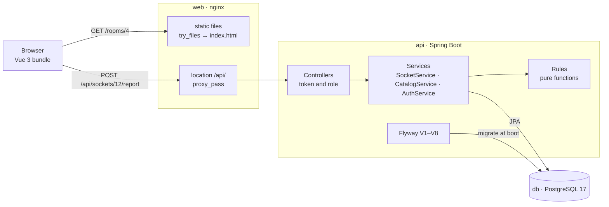

# Architecture

*Three processes, one database, and the path a single report takes through them.*

## Contents

- [Three processes](#three-processes)
- [The path of a report](#the-path-of-a-report)
- [The migrations](#the-migrations)
- [Limits of this arrangement](#limits-of-this-arrangement)

## Three processes

`docker compose up --build` starts three containers. The database comes up behind a `pg_isready` health check; the API waits for it, because the API runs the migrations on boot; the web container declares the dependency and serves the bundle regardless.

| Process | Runs | Owns |
|---|---|---|
| `db` | `postgres:17-alpine`, data on the volume `socketfinder-data` | every row: eight tables (`building`, `floor`, `room`, `seat`, `socket`, `report`, `repair`, `account`), the constraints and the indexes |
| `api` | Spring Boot on Java 21, `eclipse-temurin:21-jre`, port 8081 | sessions, the rules, every write, and the schema itself through Flyway |
| `web` | `nginx:1.27-alpine`, port 80 published as 8080 | the built Vue bundle, the single-page fallback, and the `/api` proxy |

## The path of a report



## Where the rules live

The rules are static functions in one class, `hku.sf.service.Rules`: score, weight, staleness, the daily quota, the per-socket window, and `winningState`, which sums the three heaviest weights per candidate state and applies the 1.6 threshold and the 1.5× lead. Nothing there touches Spring, a repository or a clock of its own: the caller passes `now` in, so the trust model is testable without a database. `RulesTest` does that in eleven cases — threshold, dominance, the three-account cap, the window, the quota, the stale boundary, the prior. What the system believes fits in 92 lines.

Services own the transaction and the writes, controllers own authentication and the role check, repositories are Spring Data interfaces with two hand-written queries: `lastReportPerAccount` uses PostgreSQL `distinct on` so each account counts once, and `queueByStates` orders by `last_checked_at` ascending, oldest check first.

## What one report does, in order

1. Read the token, resolve the account, refuse anything but a student with 401 or 403.
2. Find the socket, or answer 404.
3. Parse the state and accept only works, loose or no power, or answer 400.
4. Count this account's reports on this socket in 24 hours; any hit is 429.
5. Count this account's reports since midnight; the eleventh is 429.
6. Insert the report row.
7. Build the evidence: each account's latest report in the 72-hour window, weighted by its own score, top three per state.
8. If a state clears 1.6 and leads by 1.5×, write the socket's state and check time and report `flipped`.
9. Answer with the socket, the flag, and the evidence reached so far.

All nine steps run inside one `@Transactional` method, `SocketService.report`.

## What a repair settles

A repair is the only thing that moves a score. It writes the `repair` row (socket, staff, optional note, time) and settles the window: every account's last report on that socket inside 72 hours is confirmed if it named the state the socket was in, refuted if it did not. Then the socket becomes repaired and its check time is stamped. A socket that is working, repaired or never checked settles nothing, so a repair cannot farm credit.

## The migrations

- **V1** creates the eight tables, with `UNIQUE` on `account.email`, `building.code` and `room.code`, a `CHECK` on `account.role`, and two indexes: `(socket_id, created_at)` and `(account_id, socket_id, created_at)`.
- **V2** seeds Chi Wah L1: rooms, seats with coordinates, sockets, and states that give the colours meaning.
- **V3** adds `socket.code` in the form building-floor-room-seat-socket and makes it unique.
- **V4** renumbers to `building-room-0001`, one sequence per room, drops the global room-code uniqueness and replaces it with `UNIQUE (floor_id, code)` — a room code is unique inside its floor.
- **V5** allows loose and no power in both the report and the socket `CHECK` constraints; `BROKEN` stays so older rows still read.
- **V6** adds CPD, MW and KK, six seats per room, one or two sockets per seat, and a socket stamped 45 days back for the stale path.
- **V7** adds Study room 4 by hand, for the demo.
- **V8** adds the `confirmed` and `refuted` counters to `account`, which is what turns a report into a weight.

## One origin

The browser only talks to the `web` container. nginx serves `index.html` for any unknown path, so a refresh on `/rooms/4` is not a 404, and forwards `/api/` to `backend:8081/api/`. One origin takes CORS out of the browser's path; `WebConfig` keeps a CORS rule for the Vite dev server, whose origin arrives as `SF_CORS_ORIGIN`.

```
socket-finder/
├── backend/src/main/java/hku/sf/          web · service · repo · domain · config
├── backend/src/main/resources/db/migration/   V1–V8, schema then seed
├── frontend/src/                          views · components · i18n · stores
├── frontend/nginx.conf                    static files, SPA fallback, /api proxy
├── docs/                                  these pages, screenshots, loop diagrams
├── scripts/                               check-readmes.sh, i18n-check.mjs
└── docker-compose.yml                     db, api, web
```

## Limits of this arrangement

- **There is no row lock.** Two reports on the same socket arriving together can both read the evidence, both decide, and the last write wins. The fix is a `SELECT … FOR UPDATE` on the socket row, or a version column with an optimistic retry; neither is in yet.
- **Sessions are per process.** Tokens live in a map in memory, so a restart signs everyone out and a second API container would not share them.
- **Everything is computed on read.** Staleness, evidence and the queue are queries rather than scheduled work, which keeps them honest but makes a room view a handful of round trips. At campus scale the queue would be paged, the building tree cached, sessions moved to a shared store, and the socket row locked on write.

---

← [README](../README.md) · Next: [Screens](screens.md)
