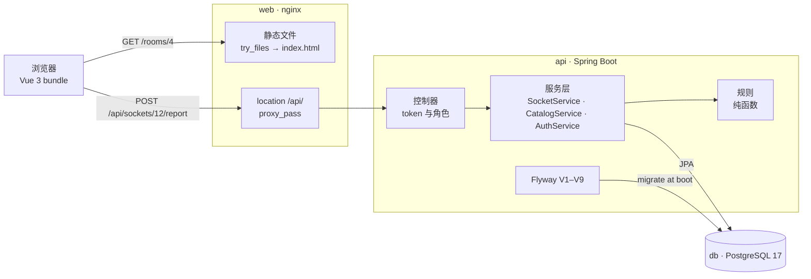

# 架构

*三个进程、一个数据库，以及一份上报穿过它们的那条路。*

## 目录

- [三个进程](#三个进程)
- [一份上报的路径](#一份上报的路径)
- [迁移](#迁移)
- [这套安排的局限](#这套安排的局限)

## 三个进程

`docker compose up --build` 会启动三个容器。数据库起在 `pg_isready` 健康检查之后；接口等它，因为接口在启动时就跑迁移；web 容器声明了这层依赖，但不管怎样都会把包发出去。

| 进程 | 跑什么 | 拥有什么 |
|---|---|---|
| `db` | `postgres:17-alpine`，数据在卷 `socketfinder-data` 上 | 每一行：八张表（`building`、`floor`、`room`、`seat`、`socket`、`report`、`repair`、`account`），以及约束和索引 |
| `api` | Java 21 上的 Spring Boot，`eclipse-temurin:21-jre`，端口 8081 | 会话、规则、每一次写入，以及通过 Flyway 管着的表结构本身 |
| `web` | `nginx:1.27-alpine`，端口 80 发布为 8080 | 构建好的 Vue 包、单页回退，以及 `/api` 代理 |

## 一份上报的路径



## 规则住在哪里

规则是同一个类里的静态函数：`hku.sf.service.Rules`，里面有分数、权重、过期、每日配额、每个插座的窗口，以及 `winningState`——它按候选状态把最重的三个权重相加，再套上 1.6 阈值和 1.5 倍领先。那里没有任何东西碰 Spring、仓库或自己的时钟：调用方把 `now` 传进去，所以信任模型不用数据库就能测。`RulesTest` 用十一个用例来做这件事——阈值、优势、三个账号的上限、窗口、配额、过期边界、先验。系统所相信的东西，92 行装得下。

服务层管事务和写入，控制器管认证和角色检查，仓库是 Spring Data 接口，只有两条手写查询：`lastReportPerAccount` 用 PostgreSQL 的 `distinct on`，让每个账号只算一次；`queueByStates` 按 `last_checked_at` 升序排，核查最旧的排在最前。

## 一份上报按顺序做了什么

1. 读 token，解析出账号，除了学生以外的角色一律用 401 或 403 拒绝。
2. 找到那个插座，否则回答 404。
3. 解析状态，只接受 works、loose 或 no power，否则回答 400。
4. 数这个账号 24 小时内在这个插座上的上报；只要有一条就是 429。
5. 数这个账号从零点起的上报；第十一份是 429。
6. 插入上报行。
7. 组装证据：每个账号在 72 小时窗口里最新的一份上报，按它自己的分数加权，每个状态取最重的三个。
8. 如果一个状态过了 1.6 并且领先 1.5 倍，写下插座的状态和核查时间，并报告 `flipped`。
9. 回答插座、这个标记，以及到目前为止凑到的证据。

九个步骤都跑在一个 `@Transactional` 方法里：`SocketService.report`。

## 一次维修结算了什么

维修是唯一会动分数的事情。它写下 `repair` 行（插座、维护人员、可选备注、时间）并结算窗口：每个账号在这个插座上 72 小时内最新的一份上报，说中了插座当时状态的就是 confirmed，没说中的就是 refuted。然后插座变成已修，核查时间被盖上。一个正常、已修或从未检查过的插座什么都结算不了，所以维修刷不出信用。

## 迁移

- **V1** 建八张表，`account.email`、`building.code` 和 `room.code` 上有 `UNIQUE`，`account.role` 上有 `CHECK`，还有两个索引：`(socket_id, created_at)` 和 `(account_id, socket_id, created_at)`。
- **V2** 灌入智华 L1：房间、带坐标的座位、插座，以及让颜色有意义的那些状态。
- **V3** 加上 `socket.code`，形如 楼-层-房-座-插座，并让它唯一。
- **V4** 改号成 `building-room-0001`，每个房间一条序列，去掉房号全局唯一，换成 `UNIQUE (floor_id, code)`——房号在它自己那层里唯一。
- **V5** 让上报和插座的 `CHECK` 约束都允许 loose 和 no power；`BROKEN` 留着，好让旧行还读得通。
- **V6** 加上 CPD、MW 和 KK，每间房六个座位，每个座位一到两个插座，还有一个盖上 45 天前时间的插座，用来走过期那条路。
- **V7** 手写加上学习室 4，为了演示。
- **V8** 给 `account` 加上 `confirmed` 和 `refuted` 两个计数器，正是它让一份上报变成一个权重。

## 一个源

浏览器只跟 `web` 容器说话。nginx 对任何不认识的路径都发 `index.html`，所以在 `/rooms/4` 上刷新不会变成 404，并且把 `/api/` 转发到 `backend:8081/api/`。只有一个源，就把 CORS 从浏览器的路上拿掉了；`WebConfig` 为 Vite 开发服务器留着一条 CORS 规则，它的源通过 `SF_CORS_ORIGIN` 传进来。

```
socket-finder/
├── backend/src/main/java/hku/sf/              web · service · repo · domain · config
├── backend/src/main/resources/db/migration/   V1–V9，先建结构再灌种子
├── frontend/src/                              views · components · i18n · stores
├── frontend/nginx.conf                        静态文件、SPA 回退、/api 代理
├── docs/                                      这些页面、截图、循环图
├── scripts/                                   check-readmes.sh、i18n-check.mjs
└── docker-compose.yml                         db、api、web
```

## 这套安排的局限

- **没有行锁。** 同一个插座上同时到达的两份上报，可以都读到证据、都做出判断，最后一次写入赢。修法是给插座那一行加 `SELECT … FOR UPDATE`，或者加一个版本列做乐观重试；两个都还没上。
- **会话是按进程的。** token 存在内存里的一个 map 中，所以重启会让所有人退出登录，第二个接口容器也不会共享它们。
- **一切都在读的时候算。** 过期、证据和队列都是查询，而不是定时任务，这让它们保持诚实，但也让一次房间视图变成几次往返。到了校园规模，队列要分页，楼的那棵树要缓存，会话要搬到一个共享存储，写入时要锁住插座那一行。

---

← [README](../README.md) · 下一页：[界面](screens.zh-CN.md)
