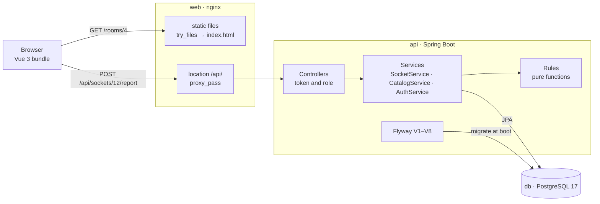

# 架構

*三個行程、一個資料庫，以及一筆上報穿過它們的路徑。*

## 目錄

- [三個行程](#三個行程)
- [一筆上報的路徑](#一筆上報的路徑)
- [遷移](#遷移)
- [這套安排的極限](#這套安排的極限)

## 三個行程

`docker compose up --build` 會起三個容器。資料庫在 `pg_isready` 健康檢查後面起來；API 等它，因為 API 在開機時跑遷移；web 容器宣告了這項依賴，但不管怎樣都先把打包好的檔案服務出去。

| 行程 | 跑什麼 | 擁有什麼 |
|---|---|---|
| `db` | `postgres:17-alpine`，資料放在磁碟區 `socketfinder-data` 上 | 每一列：八張表（`building`、`floor`、`room`、`seat`、`socket`、`report`、`repair`、`account`），以及約束和索引 |
| `api` | Java 21 上的 Spring Boot，`eclipse-temurin:21-jre`，連接埠 8081 | 工作階段、規則、每一次寫入，以及透過 Flyway 管出來的結構本身 |
| `web` | `nginx:1.27-alpine`，連接埠 80 對外發佈為 8080 | 打包好的 Vue 前端、單頁應用回退，以及 `/api` 反向代理 |

## 一筆上報的路徑



## 規則住在哪裡

規則是一個類別裡的靜態函式，`hku.sf.service.Rules`：分數、權重、過時、每日配額、每個插座的窗口，以及 `winningState`——它把每個候選狀態最重的三個權重相加，套用 1.6 門檻和 1.5 倍的領先。那裡沒有任何東西碰 Spring、repository 或自己的時鐘：呼叫者把 `now` 傳進去，所以信任模型不需要資料庫就能測試。`RulesTest` 用十一個案例做這件事——門檻、優勢、三個帳號的上限、窗口、配額、過時邊界、先驗。整個系統相信的東西，92 行放得下。

Service 擁有交易和寫入，controller 擁有身分驗證和角色檢查，repository 是 Spring Data 介面，只有兩條手寫查詢：`lastReportPerAccount` 用 PostgreSQL 的 `distinct on`，讓每個帳號只算一次；`queueByStates` 按 `last_checked_at` 遞增排序，核查最舊的排最前。

## 一筆上報依序做什麼

1. 讀權杖、解析出帳號，除了學生以外一律以 401 或 403 拒絕。
2. 找到插座，否則回 404。
3. 解析狀態，只接受 works、loose 或 no power，否則回 400。
4. 數這個帳號 24 小時內在這個插座上的上報；有任何一筆就是 429。
5. 數這個帳號從午夜以來的上報；第十一筆是 429。
6. 寫入上報資料列。
7. 建立證據：72 小時窗口內每個帳號最新的一筆上報，按它自己的分數加權，每個狀態取最重的三個。
8. 如果某個狀態越過 1.6 且領先達 1.5 倍，寫下插座的狀態和核查時間，並回報 `flipped`。
9. 用插座、這個旗標，以及目前累積到的證據來回答。

這九個步驟都跑在同一個 `@Transactional` 方法裡：`SocketService.report`。

## 一次維修結算什麼

維修是唯一會移動分數的事。它寫下 `repair` 資料列（插座、工作人員、可選備註、時間）並結算窗口：72 小時內每個帳號在那個插座上最新的一筆上報，指出的狀態正是插座當下狀態的算 confirmed，否則算 refuted。接著插座變成已修復，核查時間被蓋上。一個正常、已修復或從未核查的插座什麼都不會結算，所以維修沒辦法刷信用。

## 遷移

- **V1** 建立八張表，`account.email`、`building.code` 和 `room.code` 上有 `UNIQUE`，`account.role` 上有 `CHECK`，還有兩個索引：`(socket_id, created_at)` 和 `(account_id, socket_id, created_at)`。
- **V2** 預置智華館 L1：房間、帶座標的座位、插座，以及讓顏色有意義的狀態。
- **V3** 加入 `socket.code`，形式為 樓宇-樓層-房間-座位-插座，並讓它唯一。
- **V4** 改成 `building-room-0001` 的編號方式，每個房間一組序列，拿掉房間編號的全域唯一性，換成 `UNIQUE (floor_id, code)`——一個房間編號在它所屬的樓層內唯一。
- **V5** 在上報和插座的 `CHECK` 約束裡都允許 loose 和 no power；`BROKEN` 留著，讓舊資料列還讀得出來。
- **V6** 加入 CPD、MW 和 KK，每個房間六個座位，每個座位一到兩個插座，以及一個蓋成 45 天前的插座，用來走過時的路徑。
- **V7** 手動加入 Study room 4，給示範用。
- **V8** 在 `account` 上加入 `confirmed` 和 `refuted` 兩個計數，正是它們把一筆上報變成一個權重。

## 同一個來源

瀏覽器只跟 `web` 容器說話。nginx 對任何不認得的路徑都回 `index.html`，所以在 `/rooms/4` 上重新整理不會是 404，並且把 `/api/` 轉給 `backend:8081/api/`。單一來源讓 CORS 從瀏覽器的路徑上消失；`WebConfig` 仍保留一條給 Vite 開發伺服器的 CORS 規則，它的來源從 `SF_CORS_ORIGIN` 進來。

```
socket-finder/
├── backend/src/main/java/hku/sf/          web · service · repo · domain · config
├── backend/src/main/resources/db/migration/   V1–V8, schema then seed
├── frontend/src/                          views · components · i18n · stores
├── frontend/nginx.conf                    static files, SPA fallback, /api proxy
├── docs/                                  these pages, screenshots, loop diagrams
├── scripts/                               check-readmes.sh, i18n-check.mjs
└── docker-compose.yml                     db, api, web
```

## 這套安排的極限

- **沒有資料列鎖。** 同一個插座上兩筆一起到達的上報，可能都讀到證據、都做出判斷，最後寫入的贏。解法是對插座那一列下 `SELECT … FOR UPDATE`，或用版本欄位加樂觀重試；兩個都還沒做。
- **工作階段是每個行程各一份。** 權杖存在記憶體裡的一個 map，所以重啟就把所有人登出，而第二個 API 容器也不會共享它們。
- **一切都在讀取時算。** 過時、證據和隊列都是查詢，而不是排程工作，這讓它們保持誠實，卻也讓一個房間頁變成好幾趟來回。到了校園規模，隊列要分頁、樓宇樹要快取、工作階段要搬到共享的儲存、寫入時要鎖住插座那一列。

---

← [README](../README.md) · 下一頁：[畫面](screens.md)
