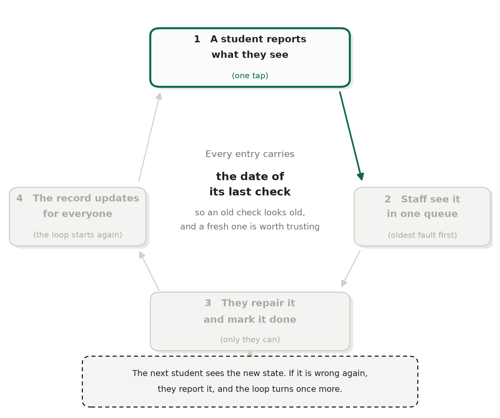
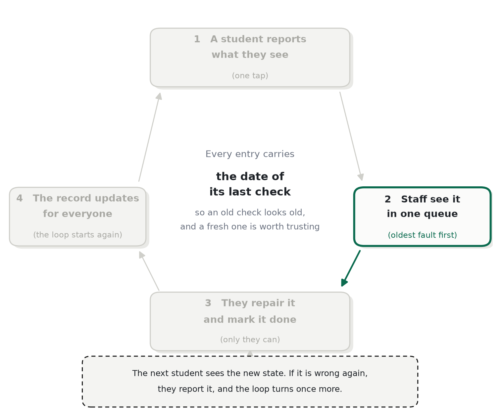
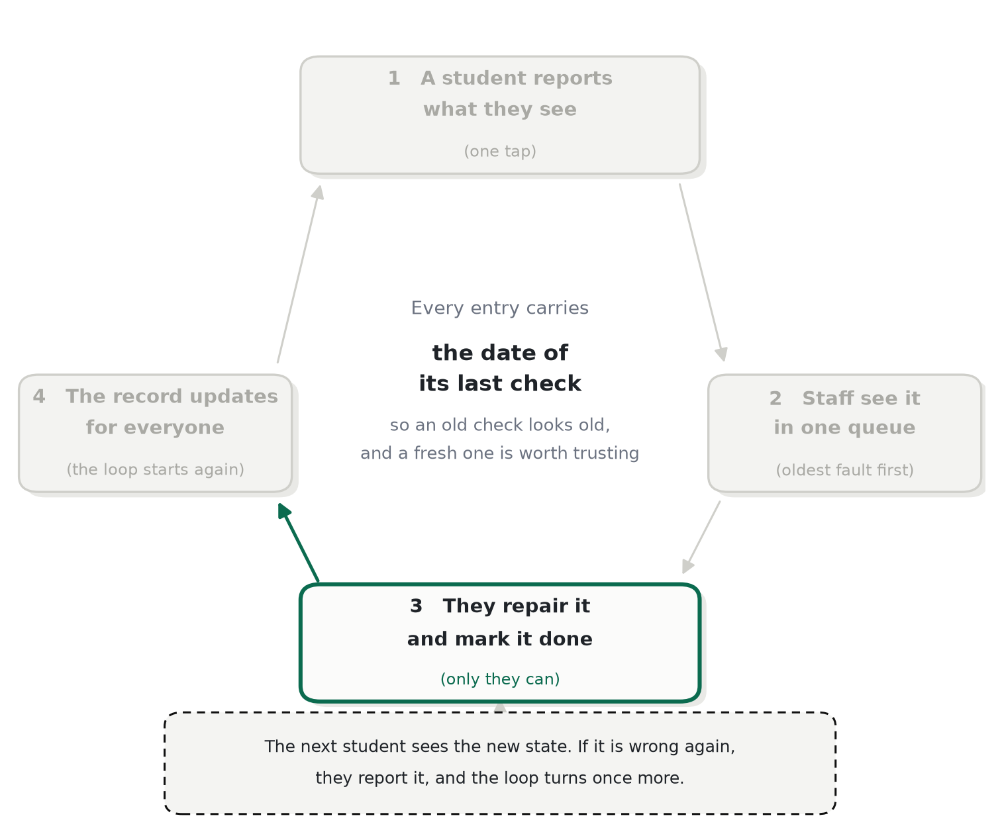
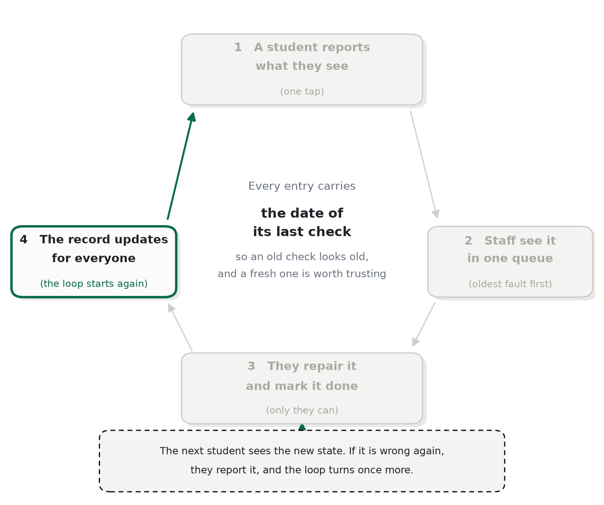

# The loop

*Who acts at each step, and what moves a socket between states.*

Sure Socket has no sensors and nobody maintains the data by hand. Everything it knows came from one loop, and
the loop only turns because each step gives the next person a reason to take it.

## The five steps

1. **A student looks.** They open a room and read the state and the date of the last check for each socket.
   What they get: a decision about where to sit. What it costs them: nothing.
2. **A student reports.** From an open room, three taps: the socket, and what is wrong with it. What they get:
   the socket changes colour immediately, and the record now includes them.
3. **Another student confirms.** Independent evidence is what turns one opinion into a fact. What the second
   student gets: a socket that is now correctly marked for the next person, including themselves.
4. **Staff repair and close.** The queue is ordered by the oldest check first, with the number of accounts
   behind each row, so the worst socket is always at the top. Closing stamps the time.
5. **The next student reads it.** The repair and its date are on the socket. They either trust it or check
   again — and that check is step one of the next turn.

## The states, and what moves a socket between them

| State | What it means | What moves it |
|---|---|---|
| Not checked | Nobody has looked since the record began | A report, or a repair, stamps a first date |
| Works | Confirmed working by evidence | Weighted evidence for "loose" or "no power" clearing the threshold |
| Loose | The plug makes contact but wobbles — the common fault | Evidence for "works" or "no power", or a repair |
| No power | Nothing comes out of it | Evidence for "works" or "loose", or a repair |
| Repaired | Staff closed a repair and stamped the time | The next report, when somebody checks again |

Nothing moves on a single voice. A state needs **1.6** of weighted evidence behind it, from the three heaviest
accounts in the last **72 hours**, and it must lead any rival state by **1.5×**. Two fresh accounts weigh
1.0 each and clear it; the heaviest possible account weighs 1.5 and cannot.

## Why two reports and not one

One report is a claim; two independent reports are a measurement. The rule is not about politeness — it is
what makes the record worth reading. It also decides what the product can promise: not "this socket is
certainly working", but "this socket was working when two people last looked", which is a claim the app can
defend.

The threshold is why the reputation score exists. An account that has been right before is worth more than an
account nobody has seen, and the difference is expressed as weight rather than as a permission: no score, not
even a perfect one, lets a single person move a socket.

## What "old" means

A check older than **30 days** is shown as stale in the interface. Nothing is deleted and nothing is silently
presented as fresh: the date is always visible, and after thirty days the interface says so in words. A record
that admits its age is more useful than one that hides it.

## What breaks the loop

- **If nobody reports,** the record is whatever the last check said, and it ages into uselessness.
- **If nobody closes a repair,** the queue becomes an inbox and the record never changes: the loop stalls at
  step four, which is why closure is restricted to staff and why the queue is ordered by neglect.
- **If nobody trusts the record,** the reports stop, and the loop returns to the first failure.

Every design decision in this repository is downstream of those three failure modes.

---

← [README](../README.md) · Next: [Why the state can be trusted](trust.md)
