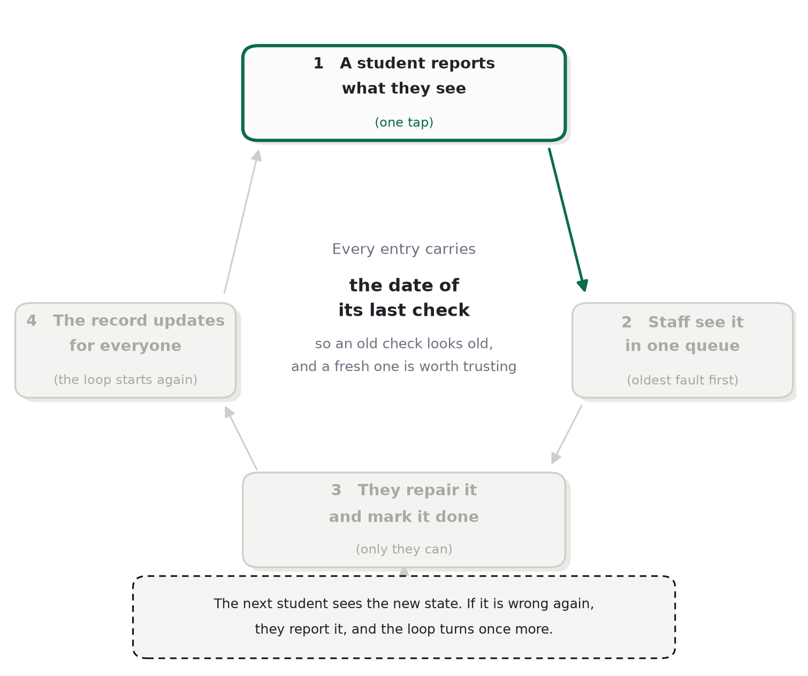
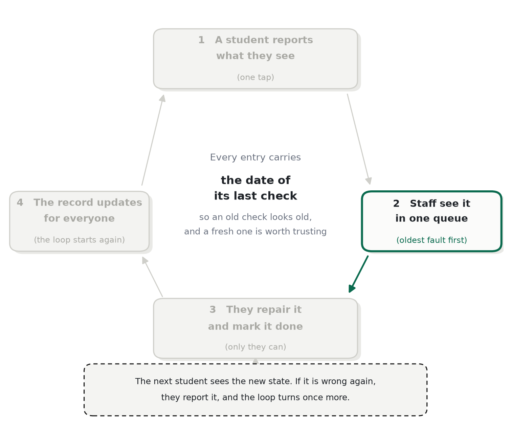
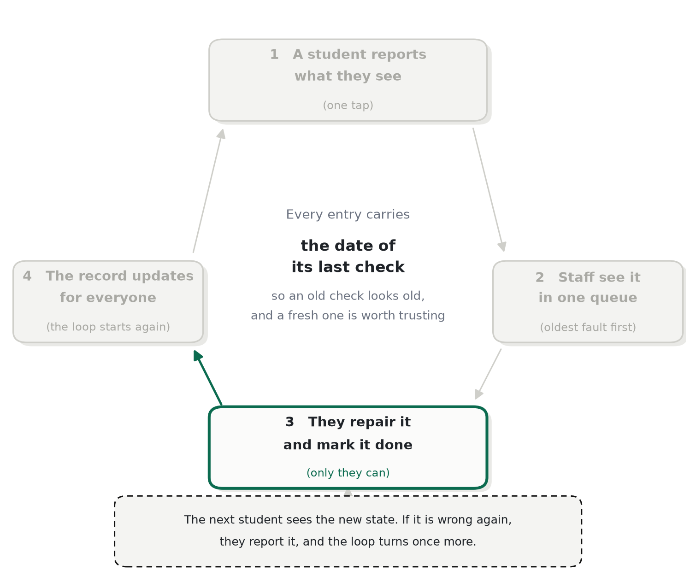
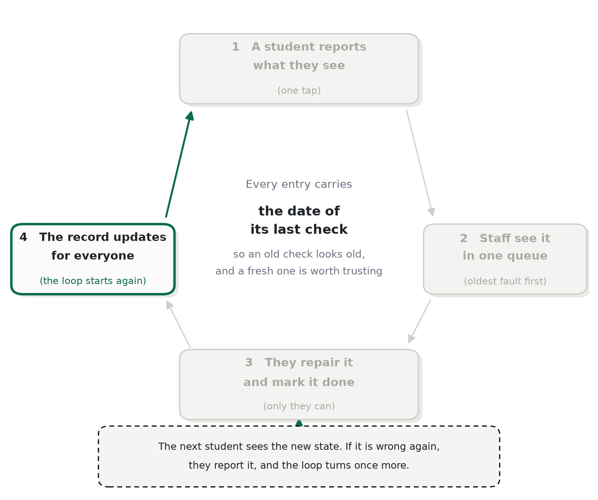

# 循环

*每一步由谁行动，以及什么让插座在状态之间移动。*

Sure Socket 没有传感器，也没有人手工维护数据。它知道的每一件事都来自同一个循环，而这个循环之所以能转，
是因为每一步都给了下一个人走下一步的理由。

## 五个步骤

1. **一名学生看一眼。** 他打开房间，读到每个插座的状态和上次核查的日期。他得到的是：一个决定，坐哪里。
   他付出的是：没有。
2. **一名学生上报。** 从一个已打开的房间出发，三次点击：哪个插座，它哪里坏了。他得到的是：插座立刻变色，
   而且这条记录里现在包含了他。
3. **另一名学生确认。** 独立的证据才是把一个人的看法变成事实的东西。第二名学生得到的是：一个现在为
   下一个人正确标注的插座，包括他自己。
4. **维修人员修复并关闭。** 队列按最旧的核查排在最前，每行带着它背后的账号数，所以最糟的插座总在最上面。
   关闭时盖上时间戳。
5. **下一名学生读到它。** 修复和它的日期就在这个插座上。他要么信任它，要么再核查一次——而那次核查就是
   下一轮的第一步。

## 状态，以及什么让插座在它们之间移动

| 状态 | 它意味着什么 | 什么会移动它 |
|---|---|---|
| 未核查 | 从记录开始以来没有人看过 | 一次上报，或一次修复，会盖上第一个日期 |
| 正常 | 已被证据确认可用 | 支持「松动」或「无电」的加权证据越过阈值 |
| 松动 | 插头能接触但会晃——最常见的故障 | 支持「正常」或「无电」的证据，或一次修复 |
| 无电 | 完全没有电出来 | 支持「正常」或「松动」的证据，或一次修复 |
| 已修复 | 维修人员关闭了一次修复并盖上时间 | 下一次上报，当有人再核查的时候 |

没有哪个状态靠一个声音移动。一个状态需要背后有 **1.6** 的加权证据，来自过去 **72 小时**内最重的三个
账号，并且必须领先任何竞争状态 **1.5×**。两个新账号各重 1.0，可以越过它；最重的可能账号重 1.5，
却越不过去。

## 为什么是两条上报而不是一条

一条上报是一个主张；两条独立的上报是一次测量。这条规则不是为了客气——它才是让记录值得一读的东西。
它也决定了这个产品能承诺什么：不是「这个插座肯定能用」，而是「这个插座在最近两个人看的时候是能用的」，
这是一个应用能够站得住脚的主张。

阈值正是信誉分存在的原因。一个以前一直对的账号，比一个谁也没见过的账号更有价值，而这个差别是用权重
表达的，不是用权限表达的：没有任何分数，哪怕满分，能让一个人单独移动一个插座。

## 「旧」是什么意思

超过 **30 天**的核查在界面上会显示为过期。什么也不会被删除，什么也不会被悄悄当作新鲜的呈现：日期始终
可见，三十天之后界面会用文字说明这一点。一个承认自己年纪的记录，比一个把它藏起来的记录更有用。

## 什么会打断循环

- **如果没有人上报，** 记录就停在上次核查说的样子，并且一路旧到没用。
- **如果没有人关闭一次修复，** 队列就变成一个收件箱，记录永远不变：循环卡在第四步，这就是为什么关闭
  被限制为只有维修人员可以做，也是为什么队列按被忽视的时间排序。
- **如果没有人信任记录，** 上报就停止，循环回到第一种失败。

这个仓库里的每一个设计决定，都是这三种失败模式的下游产物。

---

← [README](../README.md) · 下一页：[为什么状态值得信任](trust.md)
