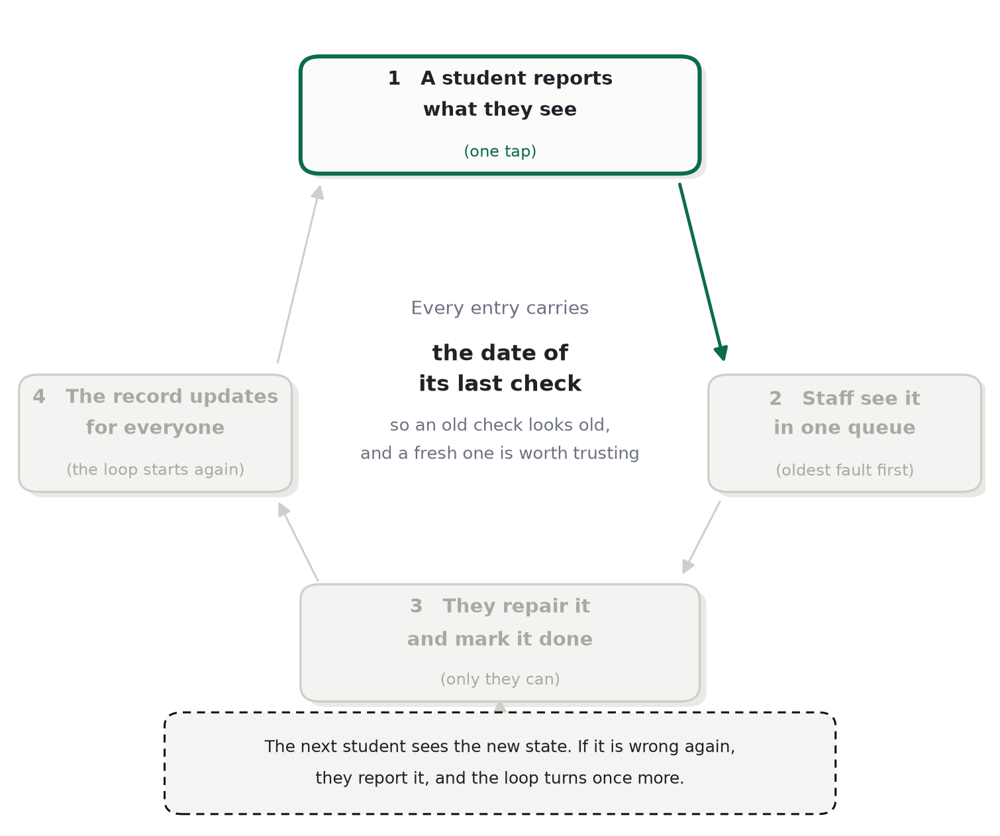
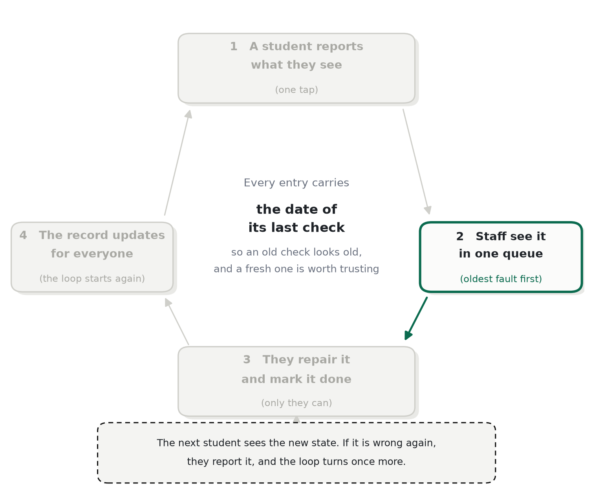
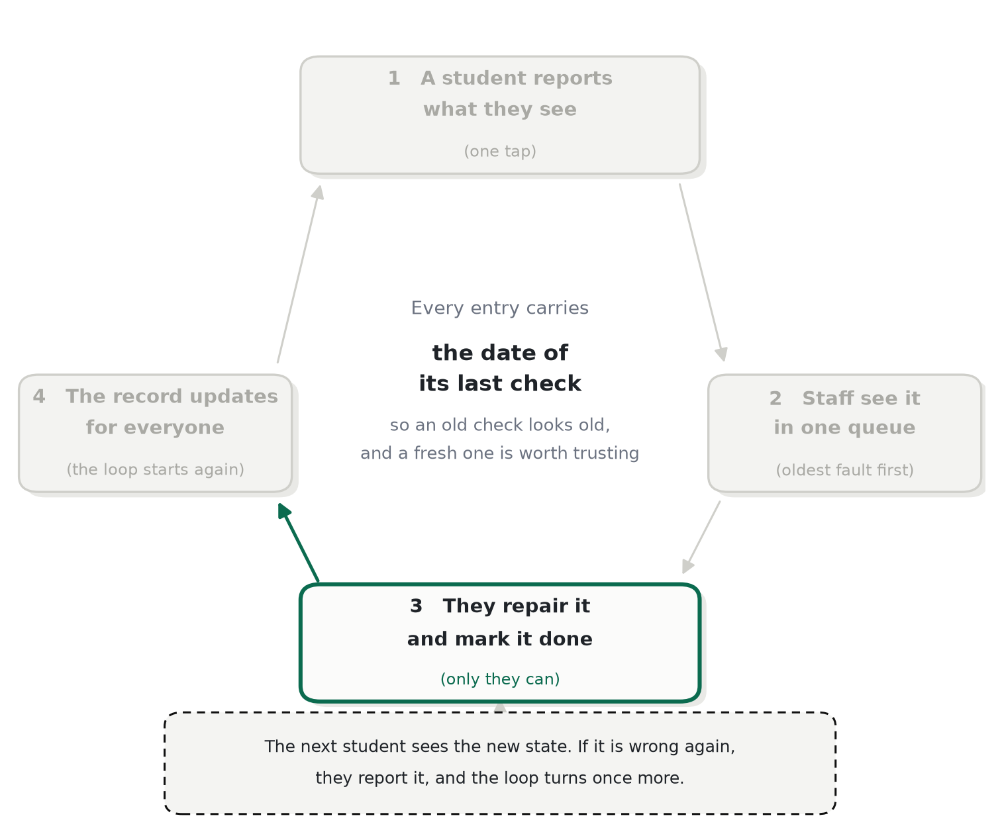
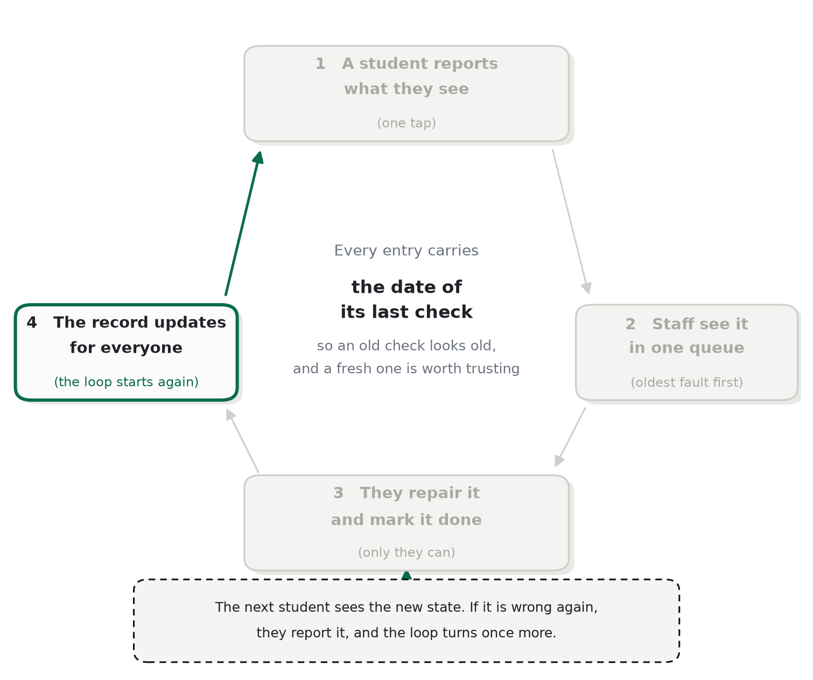

# 循環

*每一步由誰動手，以及甚麼讓插座在狀態之間移動。*

Sure Socket 沒有感測器，也沒有人手工維護資料。它知道的每一件事都來自同一個循環，而循環之所以轉得動，只因為每一步都給了下一個人動手的理由。

## 五個步驟

1. **一個學生看。** 他們打開一個房間，讀每個插座上一次核查的狀態和日期。他們得到甚麼：一個關於該坐哪裡的決定。他們付出甚麼：沒有。
2. **一個學生報告。** 從一個已打開的房間出發，三下：哪個插座，以及它哪裡壞了。他們得到甚麼：插座立刻變色，而紀錄現在包括了他們。
3. **另一個學生確認。** 獨立的證據才把一個意見變成一個事實。第二個學生得到甚麼：一個現在為下一個人正確標示的插座，包括他們自己。
4. **職員維修並關閉。** 隊列按最舊的核查優先排序，每一行旁邊有它背後的帳號數目，所以最差的插座總在最上面。關閉會蓋上時間。
5. **下一個學生讀到它。** 維修和它的日期就在插座上。他們要麼信它，要麼再核查一次——而那一次核查就是下一輪的第一步。

## 狀態，以及甚麼讓插座在它們之間移動

| 狀態 | 意思 | 甚麼會移動它 |
|---|---|---|
| 未核查 | 紀錄開始以來還沒有人看過 | 一條報告或一次維修，蓋上第一個日期 |
| 正常 | 由證據確認可以使用 | 支持「鬆脫」或「無電」的加權證據越過門檻 |
| 鬆脫 | 插頭接觸得到但會晃——最常見的故障 | 支持「正常」或「無電」的證據，或一次維修 |
| 無電 | 甚麼都沒有從它出來 | 支持「正常」或「鬆脫」的證據，或一次維修 |
| 已修 | 職員關閉了一項維修並蓋上時間 | 下一次報告，當有人再核查時 |

單靠一把聲音，甚麼都不會移動。一個狀態背後需要有 **1.6** 的加權證據，取自最近 **72 小時**內最重的三個帳號，而且它必須以 **1.5×** 領先任何競爭狀態。兩個新帳號各重 1.0，可以越過；最重的帳號也只有 1.5，並不可以。

## 為甚麼是兩條報告，不是一條

一條報告是一個主張；兩條獨立的報告是一次量度。這條規則不是關於禮貌——它是讓紀錄值得一讀的東西。它同時決定了產品可以承諾甚麼：不是「這個插座肯定正常」，而是「兩個人上一次看的時候，這個插座是正常的」，而那是一個應用程式可以為自己辯護的主張。

門檻正是信譽分存在的原因。一個以前曾經正確的帳號，比一個沒有人見過的帳號更有價值，而這個差別以權重表達，而不是以權限表達：沒有分數，即使滿分，也不能讓一個人移動一個插座。

## 「舊」是甚麼意思

超過 **30 天**的核查，在介面上會顯示為變舊。甚麼都不會被刪除，也沒有任何東西會被悄悄當成新鮮的呈現：日期永遠看得見，而三十天之後，介面會用文字說出來。一個承認自己年紀的紀錄，比一個把它藏起來的紀錄有用。

## 甚麼會打斷循環

- **如果沒有人報告，** 紀錄就是上次核查所說的，並隨時間變舊而失去用處。
- **如果沒有人關閉維修，** 隊列會變成一個收件匣，而紀錄永遠不變：循環卡在第四步，所以關閉只限職員，隊列也按被忽視的程度排序。
- **如果沒有人相信紀錄，** 報告就會停止，循環回到第一個失效點。

這個儲存庫裡的每一個設計決定，都是這三種失效模式的下游。

---

← [README](../README.md) · 下一頁：[為什麼狀態可以信](trust.md)
