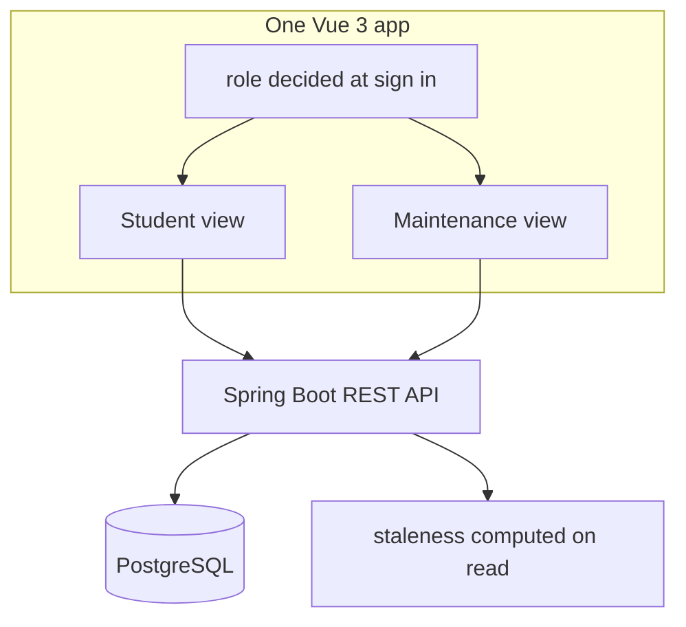
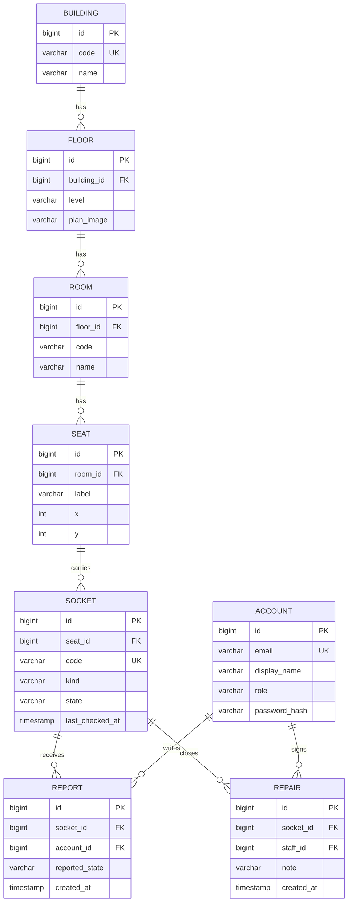
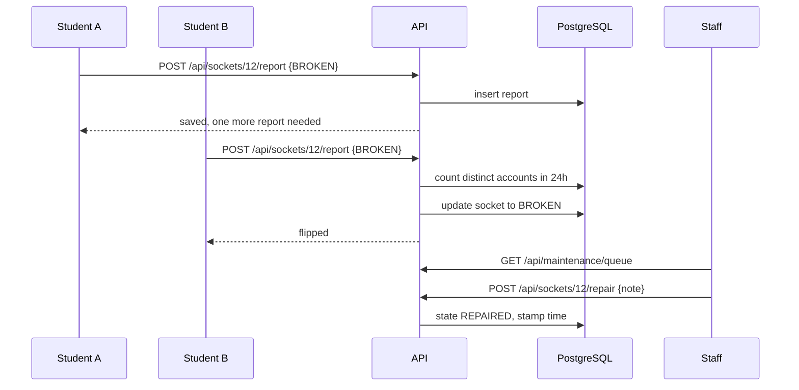

# Technical notes

How this repository is put together, and why the rules are the rules.

## 1. What this build is

Iteration 1 of Socket Finder: one socket, end to end. A student opens a room, reports a dead socket,
and the state changes only when a second student agrees. Maintenance sees the result in a queue and
closes it after a repair.

## 2. Layers

One build, two roles. The front end hides what a role cannot use; the API refuses it anyway.

## 3. Data model

| Table | Fields that matter | Why it exists |
|---|---|---|
| `account` | email, password hash, role | Two roles only: `STUDENT`, `MAINTENANCE` |
| `building` | code, name | One row per building |
| `floor` | building, level | A floor belongs to a building |
| `room` | code, floor, name | Room code is what students say out loud |
| `seat` | room, label, x, y | `x` and `y` are for a future floor plan |
| `socket` | code, seat, kind, state, last_checked_at | The unit of the whole design; `code` is unique, in the form `CPD-LG01-0001` (building code, room code, four digit sequence) |
| `report` | socket, account, state, created_at | Kept for the two-report rule and the daily limit |
| `repair` | socket, staff, note, created_at | What was fixed, by whom, when |

### Diagram

## 4. Rules

| Rule | Where it lives | Behaviour |
|---|---|---|
| Two reports to flip | `SocketService.report` | Two **different** accounts, same state, within 24 hours |
| One report per day | `SocketService.report` | Same account, same socket, second attempt returns HTTP 429 |
| Old checks look old | `Rules.isStale` | More than 30 days since the last check is flagged, never silently trusted |
| Only staff close a repair | `SocketController.repair` | Role checked on the write, not in the interface |

The staleness rule is computed when a socket is read. There is no background job that could drift from
what the database says.

## 5. What happens when someone reports

## 6. Endpoints

| Method | Path | Role | Notes |
|---|---|---|---|
| POST | `/api/auth/login` | any | returns a token, valid 8 hours |
| GET | `/api/buildings` | any | buildings with floors |
| GET | `/api/floors/{id}/rooms` | any | rooms with socket counts |
| GET | `/api/rooms/{id}` | any | seats and sockets |
| POST | `/api/sockets/{id}/report` | student | body `{"state":"BROKEN"}` |
| POST | `/api/sockets/{id}/repair` | maintenance | body `{"note":"..."}` |
| GET | `/api/maintenance/queue` | maintenance | broken sockets, oldest first |

## 7. States

| State | Set by | Meaning |
|---|---|---|
| `UNKNOWN` | seed data | nobody has checked this socket |
| `WORKING` | two reports | two students confirm it charges |
| `BROKEN` | two reports | two students confirm it does not |
| `REPAIRED` | maintenance | staff fixed it, nobody has confirmed yet |

## 8. Limits of this build

- Tokens are kept in memory, so a restart signs everyone out.
- Accounts are seeded, and nothing proves the account belongs to a HKU student.
- Login has no rate limit.
- The rooms and sockets are hand-typed sample data for one floor.
- Photos, notifications, offline mode and floor plans are not built.

## 9. Where this goes next

The loop only stays alive while people keep reporting, so the next steps are the ones that make
reporting cheaper and the data more visible: a floor plan per level, a phone layout, and a way for
maintenance to see the same record they already keep.
