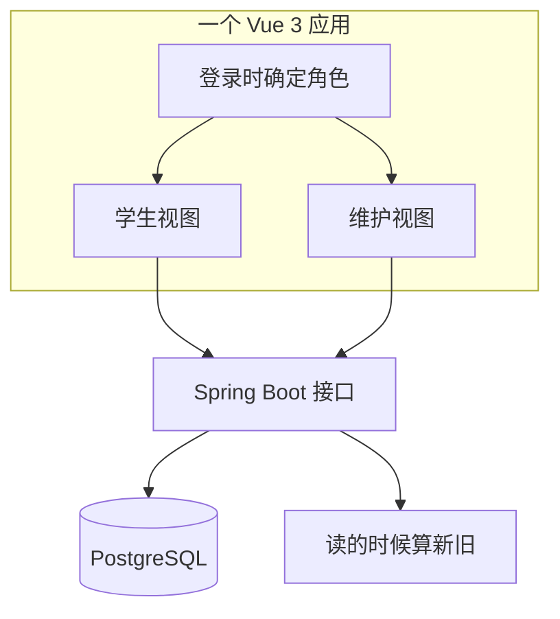
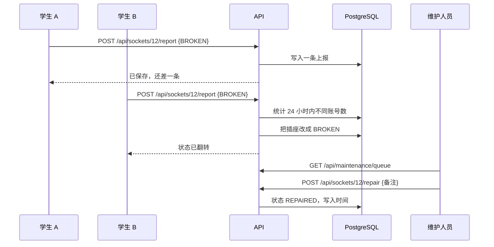

# 技术说明

这份仓库是怎么搭起来的，以及为什么规则要这么定。

## 一、这一版是什么

Socket Finder 的迭代 1：一个插座，从查到报走完一圈。学生打开房间、报一个坏插座，状态只有在第二个学生也报同样的结果时才改变；维护人员在队列里看到它，修完之后结案。

## 二、分层

一份 build，两个角色。前端会把角色用不到的东西藏起来，接口仍然会拒绝。

## 三、数据模型

| 表 | 关键字段 | 为什么需要 |
|---|---|---|
| `account` | 邮箱、密码哈希、角色 | 只有两个角色：`STUDENT`、`MAINTENANCE` |
| `building` | 代号、名称 | 一栋楼一行 |
| `floor` | 楼、楼层 | 楼层属于楼 |
| `room` | 房号、楼层、名称 | 房号就是学生平时说出口的那个 |
| `seat` | 房间、座位号、x、y | `x`、`y` 是留给以后的平面图 |
| `socket` | 编号、座位、类型、状态、上次核查时间 | 整个设计的单位；`code` 唯一，形如 `CW-L1-A-S2-B`（房间编号 + 座位标签 + 插座字母） |
| `report` | 插座、账号、上报状态、时间 | 为了「两报才翻」和每天一次的限制 |
| `repair` | 插座、维修人、备注、时间 | 谁在什么时候修了什么 |

## 四、规则

| 规则 | 写在哪 | 行为 |
|---|---|---|
| 两个人才翻转 | `SocketService.report` | 24 小时内两个**不同**账号报同一状态 |
| 每账号每天一次 | `SocketService.report` | 同账号同插座再报一次返回 HTTP 429 |
| 旧的要看得出来旧 | `Rules.isStale` | 距上次核查超过 30 天就标记，绝不默认它是新的 |
| 只有维护能结案 | `SocketController.repair` | 角色在写入时校验，不是靠界面藏按钮 |

「旧」是在读取时算出来的，不需要后台任务，也就不会出现任务和数据库不一致的情况。

## 五、有人上报时发生什么

## 六、接口

| 方法 | 路径 | 角色 | 说明 |
|---|---|---|---|
| POST | `/api/auth/login` | 所有人 | 返回 token，8 小时有效 |
| GET | `/api/buildings` | 所有人 | 楼与楼层 |
| GET | `/api/floors/{id}/rooms` | 所有人 | 房间与插座数量 |
| GET | `/api/rooms/{id}` | 所有人 | 座位与插座 |
| POST | `/api/sockets/{id}/report` | 学生 | 请求体 `{"state":"BROKEN"}` |
| POST | `/api/sockets/{id}/repair` | 维护人员 | 请求体 `{"note":"..."}` |
| GET | `/api/maintenance/queue` | 维护人员 | 坏掉的插座，最久的排前 |

## 七、状态

| 状态 | 谁写进去 | 含义 |
|---|---|---|
| `UNKNOWN` | 种子数据 | 还没人查过 |
| `WORKING` | 两条上报 | 两个学生确认能充电 |
| `BROKEN` | 两条上报 | 两个学生确认不能用 |
| `REPAIRED` | 维护人员 | 修好了，但还没人确认 |

## 八、这一版的限制

- token 存在内存里，重启就要重新登录。
- 账号是预置的，没有任何东西能证明这个账号是港大学生。
- 登录接口没有频率限制。
- 房间和插座是一层楼的手工样数据。
- 照片、通知、离线模式、平面图都还没做。

## 九、接下来往哪走

循环能转，靠的是有人愿意一直报。所以下一步都是让上报更省事、让数据更显眼：每层一张平面图、手机布局，以及让维护人员看见他们已经在自己维护的那本账。
