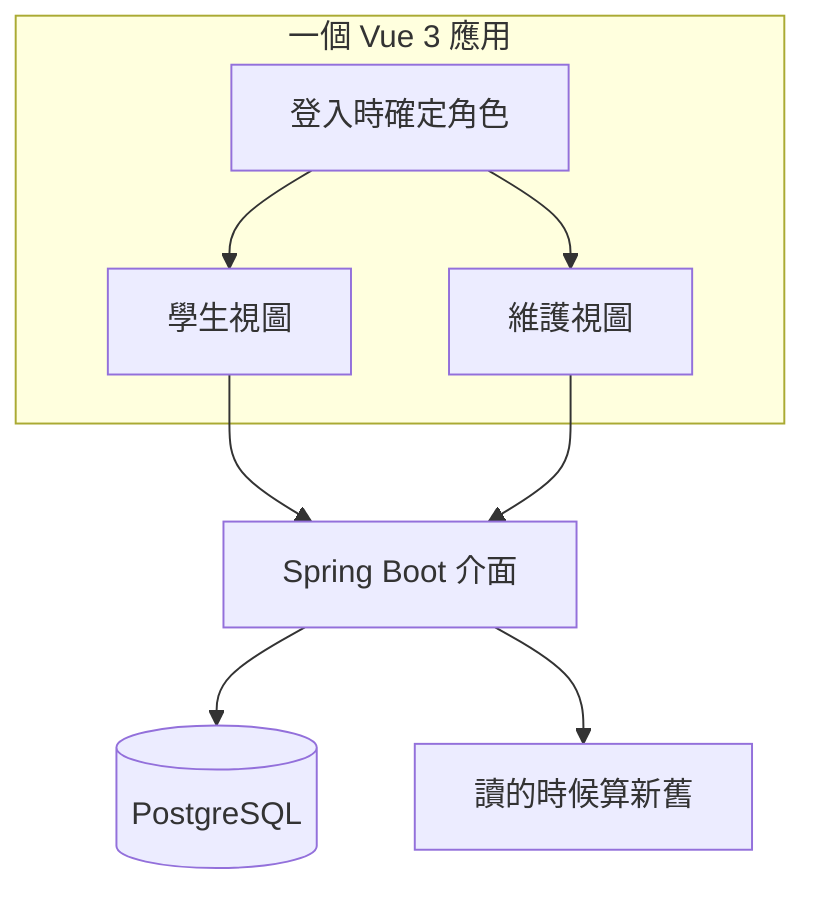
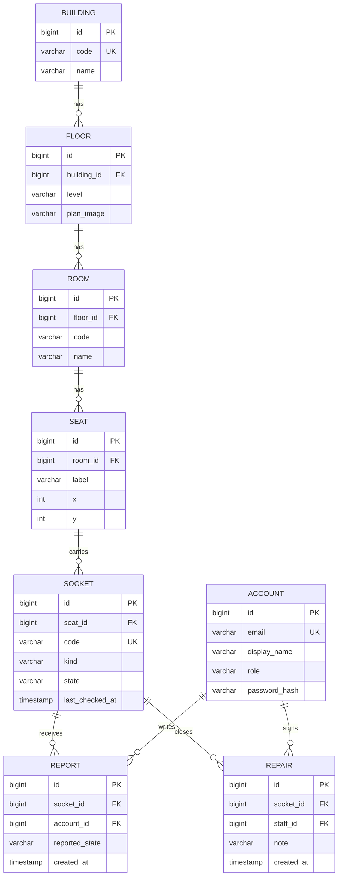
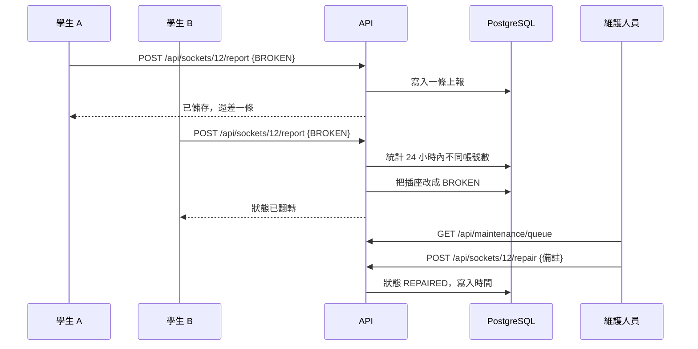

# 技術說明

這份倉庫是怎麼搭起來的，以及為什麼規則要這麼定。

## 一、這一版是什麼

Socket Finder 的迭代 1：一個插座，從查到報走完一圈。學生打開房間、報一個壞插座，狀態只有在第二個學生也報同樣的結果時才改變；維護人員在隊列裡看到它，修完之後結案。

## 二、分層

一份 build，兩個角色。前端會把角色用不到的東西藏起來，介面仍然會拒絕。

## 三、數據模型

| 表 | 關鍵欄位 | 為什麼需要 |
|---|---|---|
| `account` | 電郵、密碼雜湊、角色 | 只有兩個角色：`STUDENT`、`MAINTENANCE` |
| `building` | 代號、名稱 | 一棟樓一行 |
| `floor` | 樓、樓層 | 樓層屬於樓 |
| `room` | 房號、樓層、名稱 | 房號就是學生平時說出口的那個 |
| `seat` | 房間、座位號、x、y | `x`、`y` 是留給以後的平面圖 |
| `socket` | 編號、座位、類型、狀態、上次核查時間 | 整個設計的單位；`code` 唯一，形如 `CPD-LG01-0001`（樓號 + 房間號 + 四位序號） |
| `report` | 插座、帳號、上報狀態、時間 | 為了「兩報才翻」和每天一次的限制 |
| `repair` | 插座、維修人、備註、時間 | 誰在什麼時候修了什麼 |

### Diagram

## 四、規則

| 規則 | 寫在哪 | 行為 |
|---|---|---|
| 兩個人才翻轉 | `SocketService.report` | 24 小時內兩個**不同**帳號報同一狀態 |
| 每帳號每插座每天一次 | `SocketService.report` | 同帳號同插座再報一次回傳 HTTP 429 |
| 每帳號每天最多 10 次 | `SocketService.report` | 同帳號當天的第 11 支插座回傳 HTTP 429 `DAILY_CAP` |
| 舊的要看得出來舊 | `Rules.isStale` | 距上次核查超過 30 天就標記，絕不預設它是新的 |
| 只有維護能結案 | `SocketController.repair` | 角色在寫入時檢查，不是靠介面藏按鈕 |

「舊」是在讀取時算出來的，不需要背景任務，也就不會出現任務和資料庫不一致的情況。

## 五、有人上報時發生什麼

## 六、介面

| 方法 | 路徑 | 角色 | 說明 |
|---|---|---|---|
| POST | `/api/auth/login` | 所有人 | 回傳 token，8 小時有效 |
| GET | `/api/buildings` | 所有人 | 樓與樓層 |
| GET | `/api/floors/{id}/rooms` | 所有人 | 房間與插座數量 |
| GET | `/api/rooms/{id}` | 所有人 | 座位與插座 |
| POST | `/api/sockets/{id}/report` | 學生 | 請求體 `{"state":"BROKEN"}` |
| POST | `/api/sockets/{id}/repair` | 維護人員 | 請求體 `{"note":"..."}` |
| GET | `/api/maintenance/queue` | 維護人員 | 壞掉的插座，最久的排前 |

## 七、狀態

| 狀態 | 誰寫進去 | 含義 |
|---|---|---|
| `UNKNOWN` | 種子資料 | 還沒人查過 |
| `WORKING` | 兩條上報 | 兩個學生確認能充電 |
| `BROKEN` | 兩條上報 | 兩個學生確認不能用 |
| `REPAIRED` | 維護人員 | 修好了，但還沒人確認 |

## 八、這一版的限制

- token 存在記憶體裡，重啟就要重新登入。
- 帳號是預置的，沒有任何東西能證明這個帳號是港大學生。
- 登入介面沒有頻率限制。
- 房間和插座是一層樓的手工樣本資料。
- 照片、通知、離線模式、平面圖都還沒做。

## 九、接下來往哪走

循環能轉，靠的是有人願意一直報。所以下一步都是讓上報更省事、讓資料更顯眼：每層一張平面圖、手機佈局，以及讓維護人員看見他們已經在自己維護的那本帳。
